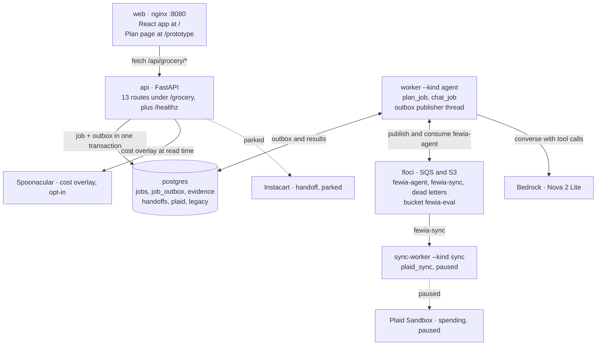

# FEWIA feature map

This map records every built feature on `main` at `285b1f3d`
(2026-10-19), the layer that owns it, and how the pieces call each other.
It reads the code first and the wiki second. A feature is live only when
a route or a screen on `main` serves it. A ledger state or a backlog line
is not evidence. Where the two disagree, this map says so.

Read it in this order:

1. System overview: the seven runtime parts and what talks to what.
2. Feature inventory: one row per feature with its status.
3. Feature connections: the five request paths and the disconnects.
4. Data model, providers, evaluation, and workflow: the detail behind
   each box.
5. Open work and the file index: what is left and where to look.

Sources: `backend/app/`, `frontend/src/`, `compose.yaml`,
[docs/FEATURE_BACKLOG.md](FEATURE_BACKLOG.md) (its own snapshot is
`26f6b0e`, 2026-10-07, before #420 to #456), `wiki/log.md`,
`wiki/decisions/`, and the ledgers in `.claude/loop/`.

## System overview

Seven Compose services run the product. The browser talks only to the
API. The API writes a job and its outbox row in one transaction. The
worker's publisher thread moves the job id to Floci, the worker consumes
it, runs the handler, and writes the result back. Providers sit at the
edge: Bedrock behind the worker, Spoonacular behind a read, Instacart and
Plaid dormant.



The `bootstrap` service seeds the demo user and the Floci queues, then
exits. The evaluation CLI drives the same runtime in-process with a
private Floci queue and its own SQLite store; it is not a service.
`compose.bedrock.yaml` and `compose.spoonacular.yaml` only add
environment to `api` and `worker`.

## Feature inventory

Twenty-three built features. Thirteen serve the `/` application today,
four are tooling that no route serves, one serves `/prototype`, two sit
dormant by decision, one is retired, and two wait on the owner or on
deployment.

| # | Feature | Layer | Entry point | Status | Note |
| --- | --- | --- | --- | --- | --- |
| 1 | Monthly budget entry and manual plan request | Frontend, API | `BudgetForm.tsx` to `POST /grocery/jobs` | Live on / | Default limit $100. Source `manual`. |
| 2 | Budget arithmetic | Domain | `calculate_budget` in `domain/budget.py` | Live on / | Limit minus posted spending, clamped to zero. Pending cents separate. Stale rule at 24 h. Optional plan cap. |
| 3 | Catalog and spending config | API | `GET /grocery/config` | Live on / | Returns 40 recipe ids, ingredient ids, catalog version `sample-prices-v2`, and the spending snapshot. |
| 4 | Deterministic grocery planner | Service | `plan_groceries` in `services/grocery_planner.py` | Live on / | 1 to 3 meals, 1 to 8 servings, pantry, exclusions, diet validation, shared-ingredient aggregation before package rounding. Typed `ExclusionConflict` and `DietConflict`. |
| 5 | Plan estimate view | Frontend | `Estimate.tsx` | Live on / | Shows lines, total, budget fit, and the sample-price notice. One live status region per job. |
| 6 | Meal templates | API, Frontend | `POST /grocery/templates`, `TemplatePicker.tsx` | Live on / | Six presets filtered through the planner. Returns up to six. Reserves no money. |
| 7 | USDA nutrition facts | Service, Frontend | `meal_nutrition` in `services/meal_nutrition.py`, `Nutrition.tsx` | Live on / | Computed inside `execute_plan` at job time. Stored in the job result. |
| 8 | Spoonacular cost overlay | Service | `attach_supermarket_estimate` on both job reads | Live on / | Read time only, never stored. Off unless `FEWIA_SPOONACULAR_KEY_FILE` is set. Budget acceptance ignores it. |
| 9 | Chat with the Bedrock agent | Agent, API | `POST /grocery/chat/jobs`, `agent/chat_loop.py` | Live on / | Tool calling with `plan_groceries` and `get_budget_summary`. 8 model turns, 3 planner revisions. Refusal parser. Needs the Bedrock overlay. |
| 10 | Chat follow-up context | Service | `services/chat_history.py`, `agent/chat_context.py` | Live on / | The server loads history and `previous_ingredient_ids` from the prior job. The client cannot send them. |
| 11 | Provider capability flags | API, Frontend | `GET /grocery/providers`, `useProviderCapabilities.ts` | Live on / | Tells the UI whether chat (Bedrock), Plaid, and Instacart are configured, and names the spending source. |
| 12 | Durable jobs | Service, Worker | `services/job_submission.py`, `worker.py` | Live on / | Idempotency key per user and kind, outbox in the same transaction, publisher thread, leases, heartbeat, recovery, dead-letter queues. |
| 13 | Evidence revisions | Service, API | `services/evidence_store.py`, `GET /grocery/evidence/{revision_id}` | Live on / | Immutable plan snapshots. The frontend reads the ids but never calls the route. |
| 14 | Instacart shopping handoff | Provider, API, Frontend | `POST /grocery/handoffs`, `HandoffControls.tsx` | Parked | Decision 0010. Button hidden unless `instacart_configured`. Retry route exists. |
| 15 | Plaid Sandbox spending sync | Provider, Sync worker | `POST /grocery/sync/jobs`, `services/plaid_sync.py` | Paused | Decision 0016 orders it last; decision 0019 records the pause. No UI calls it. Runtime role is SELECT-only on the Plaid tables. |
| 16 | Tonight Plan page | Frontend | `/prototype`, `prototype/TonightPrototype.tsx` | Prototype on /prototype | Lazy chunk. Demo data in `prototypeData.ts`. Makes no API call. Audience 18 to 25. |
| 17 | Evaluation harness and CLI | Backend | `python -m app.evaluate`, `evaluation_*.py` | Tooling | 60 modules. 138-slot matrix. Fixture runs work today. |
| 18 | Live benchmark on Nova 2 Lite | Evaluation | `eval/results/artifacts/` | Owner-gated | Last batch 2026-10-05: task 25 of 33, claims 109 of 112. Next batch waits on the A02 decision. |
| 19 | Hosted demo stacks | Infra | `infra/hosting/`, `preflight_cli.py` | Source only | CDK for ECS Fargate, RDS, Secrets Manager, CloudWatch, Cognito edge. Nothing deployed. |
| 20 | Bedrock credentials stack and session renewal | Infra | `infra/bedrock/`, `infra/bedrock_session.py` | Tooling | The owner renews the session before a live run. |
| 21 | Health-era tables and legacy runner | Database, Backend | `models.py`, `evaluation_runner.py` | Retired | Decision 0018 retains the data. No route serves it. |
| 22 | Writer supervisor, gates, review, usage | Tooling | `dev_supervisor/` | Tooling | Sonnet writes, Opus reviews. Gates print `LINES n/1000`. |
| 23 | Agent hooks, juniors, skills, CI | Tooling | `.claude/`, `.codex/`, `.github/workflows/` | Tooling | Senior edit guard, bash guard, PR size and done checks, append-only log, prose lint. Four workflows. Playwright suite from #443 and #444. |

## Feature connections

Five request paths share one spine: a screen posts, the API stores a job,
a worker runs a handler, an engine does the arithmetic, and the screen
reads the result back. Templates skip the job and answer in-line. The
handoff and sync paths are complete in code and dormant by decision.

| Path | Screen | Route | Handler | Engine | Read back |
| --- | --- | --- | --- | --- | --- |
| Manual plan, live | `BudgetForm`, post then poll | `POST /grocery/jobs`, job + outbox, idempotent | `worker`, `plan_job`, lease and heartbeat | `execute_plan`: planner, budget, USDA nutrition | `GET /grocery/jobs/{id}` + Spoonacular, `Estimate` view |
| Chat, live | `ChatPanel`, poll status | `POST /grocery/chat/jobs`, job + outbox, history by server | `worker`, `chat_job`, prior job ids | `chat_loop`: Bedrock, 8 turns, 2 typed tools | `GET /grocery/chat/jobs/{id}`, answer + trace, `ChatWorkspace` |
| Templates, live | `TemplatePicker` | `POST /grocery/templates`, no job, in-line | `plan_templates`, 6 presets | planner: budget, diet, pantry, exclusions | same response, up to 6 ideas |
| Handoff, parked | `HandoffControls`, hidden unless configured | `POST /grocery/handoffs` | `handoff_dispatch`, claim and finish | Instacart `products_link`, development | `GET /grocery/handoffs/{id}`, retry route |
| Sync, paused | none | `POST /grocery/sync/jobs` | `sync-worker`, `sync_job` | `plaid_sync`, Plaid Sandbox, serialized | `load_spending` on the plaid tables for a non-manual source |
| `/prototype`, unreached | demo data only, calls no route | none | none | `planModel.ts` | none |
| Evidence, unreached | none | `GET /grocery/evidence/{revision_id}` | none | none | no UI caller |

How the live paths feed each other:

- The manual plan and the chat turn share `execute_plan`. That one
  function calls the planner, the budget, and the nutrition, so both
  paths produce the same plan shape and the same notice.
- The chat tool `get_budget_summary` reads the same `calculate_budget`
  facts the manual path uses. It is read-only.
- A manual plan can seed the chat. `ChatWorkspace` carries the estimate
  into the first turn's context.
- A follow-up chat turn never trusts the client. `chat_history.py`
  reloads the prior job's turns and `previous_ingredient_ids` on the
  server.
- Templates run the same planner against the same budget, diet, pantry,
  and exclusions. A preset survives only if the planner accepts it.
- Every plan path writes a `grocery_evidence` revision. Only the
  evaluation harness and the evidence route read them.
- The Spoonacular overlay attaches on `GET /grocery/jobs/{id}` and on
  the chat job read. Neither stores it.
- `GET /grocery/providers` is the one switch the UI reads to show or
  hide the handoff button and the chat.

The two unreached parts: `/prototype` renders `prototypeData.ts` and
never fetches, so its plan math in `planModel.ts` is a second
implementation of the planner's aggregation and rounding. The evidence
route has no screen; the chat response carries `evidence_id` and
`evidence_revision_id`, but nothing follows them.

## Data model

PostgreSQL holds twelve tables from seven forward-only migrations. Four
carry the product today, one is parked with Instacart, two wait for
Plaid, and the rest are health-era tables that decision 0018 keeps
without a route.

| Table | Migration | Written by | Read by | State |
| --- | --- | --- | --- | --- |
| `users` | 0001 | `bootstrap_demo.py` seeds the one demo user | Every route through `DEMO_USER_ID` | Live |
| `jobs` | 0004 | `job_submission.py` on each `POST`; the worker on each state change | The three `GET .../jobs/{id}` routes; `chat_history.py` for the prior turn | Live |
| `job_outbox` | 0004 | `job_submission.py` in the same transaction as the job | `outbox_publisher.py` on the worker's publisher thread | Live |
| `grocery_evidence` | 0007 | `evidence_store.save_plan_evidence` after a plan | `GET /grocery/evidence/{revision_id}` | Live, no UI caller |
| `shopping_handoffs` | 0006 | `handoff_dispatch.py` | `GET /grocery/handoffs/{id}` | Parked with Instacart |
| `plaid_items`, `plaid_transactions` | 0005 | `plaid_sync.sync_item` on the sync worker | `ledger_budget.load_spending` for a non-manual source | Paused; runtime role is SELECT-only |
| `daily_finance`, `daily_environment`, `daily_health`, `model_runs`, `predictions` | 0001 to 0003 | Nothing on `main` | Nothing on `main` | Retired, retained |

Facts that shape every row:

- A job has `kind` `sync` or `agent`. An agent job has operation none
  (manual plan) or `chat`. The pair `(user_id, kind, request_key)` is
  unique, so a repeated idempotency key returns the same job and a
  changed body raises a conflict.
- A job stores its public result, tool trace, and user-facing
  explanation. It never stores hidden model reasoning, credentials, or
  raw provider text.
- Money is USD integer cents. Budget dates use America/New_York.
- An evidence revision is immutable. A new plan writes a new revision;
  nothing updates one.
- Floci owns two queues, `fewia-agent` and `fewia-sync`, each with a
  dead-letter queue, and one bucket, `fewia-eval`, for evaluation
  exports. `infra/floci_bootstrap.py` creates them.
- The evaluation harness keeps its own SQLite evidence store in
  `evaluation_database.py`. It never writes the product tables.

## External providers and boundaries

Six external systems touch the product. Two are on in the default stack,
two switch on by environment, and two stay off by decision.

| Provider | Adapter | Switch | State | Evidence label |
| --- | --- | --- | --- | --- |
| Floci SQS and S3 | `providers/local_sqs*.py`, `providers/local_artifacts.py`; `aws_sqs_*.py` and `aws_artifacts.py` for real AWS | `job_transport_settings.py` | On in Compose | emulator |
| USDA FoodData Central | `domain/nutrition_catalog.py`; `usda_refresh.py` rebuilds the file | None at runtime; facts ship in the catalog | On | catalog |
| Amazon Bedrock | `providers/bedrock.py` `BedrockConverseProvider` behind the `LLMProvider` protocol | `FEWIA_BEDROCK_MODEL_ID` through `compose.bedrock.yaml`; `us-east-1` or `us-west-2`; Nova 2 Lite | On when configured; plain `docker compose up` leaves chat unconfigured | live |
| Spoonacular | `providers/spoonacular.py`; `services/supermarket_overlay.py` | `FEWIA_SPOONACULAR_KEY_FILE` through `compose.spoonacular.yaml` | On when configured; off by default | live, read time |
| Instacart development | `providers/instacart.py` `InstacartDevelopmentProvider`; `POST /idp/v1/products/products_link` | `instacart_configured` from `provider_settings.py` | Parked, decision 0010 | development |
| Plaid Sandbox | `providers/plaid.py` `PlaidSandboxProvider`, `plaid_contract.py` | `plaid_client_id`, secret file, tokens file | Paused, last by decision 0016 | sandbox, none recorded |

Rules every adapter obeys:

- Credentials and raw provider responses never enter a model input, a
  job payload, or a log.
- Provider text is untrusted. The refusal parser and the answer renderer
  read it as data.
- A handoff URL is validated before the UI may navigate to it.
- Every sample-catalog estimate carries the fixed notice: "Estimated from
  the demo price catalog. Instacart prices, availability, taxes, delivery
  fees, and tips are not verified." The Spoonacular overlay carries
  `SPOONACULAR_COST_NOTICE`.
- Budget acceptance uses sample-catalog cents only. The overlay is
  information, not a rule.
- `runtime_database_policy.py` grants the hosted runtime role SELECT-only
  on the Plaid tables until Plaid resumes.

## Evaluation and evidence

The harness is built and runs on fixtures today. The last live batch on
2026-10-05 passed the claims target and failed the task target. The next
live batch waits on the owner's A02 gold decision.

**Corpus.** `grocery-eval-v1` holds 30 scenarios in six groups: spending
and budget 5, meal planning 7, follow-up and pantry 5, missing or
impossible requests 4, provider failures 5, adversarial text 4. Each runs
three times. A batch is 138 slots: 90 primary, 33 `no_tool`, 15
structured references.

**Pipeline.** `prepare_matrix` validates the corpus and returns isolated
slots. `run_evaluation_batch` drives them through the real runtime and
dispatch paths. `python -m app.evaluate` writes an exclusive journal, a
JSON report, a Markdown report, and a completion marker. The CLI fixes
4096 max tokens, temperature 0, low reasoning effort, and accepts the
Nova 2 Lite US profile only. Without `--live-bedrock` it exits before any
provider call.

**Scoring.** `evaluation_plan_score.py` compares a plan with the
deterministic planner. `evaluation_claim_score.py` and
`evaluation_outcome_score.py` score supported claims and task outcome
against `claim_propositions` and `outcome_propositions`.
`evaluation_tool_score.py` checks valid tool use. `evaluation_cost.py`
prices tokens from dated rates. `evaluation_fault_provider.py` injects
provider failures. `evaluation_duplicate.py` replays an SQS delivery on
a private queue.

| Batch | Task success | Supported claims | Record |
| --- | --- | --- | --- |
| 2026-10-05 fresh live | 25 of 33, 75.8%, target 90% FAIL | 109 of 112, 97.3%, target 95% PASS | [benchmark-20261005](../wiki/phases/benchmark-20261005.md) |
| 2026-10-03 post-hoc gold | 23 of 33, 69.7%, FAIL | unchanged | [posthoc-gold-20261003](../wiki/phases/posthoc-gold-20261003.md) |
| 2026-10-03 original live | 17 of 33, 51.5%, FAIL | 98 of 100, 98%, PASS | [benchmark-20261003](../wiki/phases/benchmark-20261003.md) |

Artifacts live under `eval/results/artifacts/` with SHA-256 manifests.
`eval/probes/` holds two pantry probe scripts. The course pack under
`docs/course/` links prompts, figures, and failure examples; the owner
writes the paper. No model prose goes into an evaluation record.

## Engineering workflow

Every feature above shipped through one loop: the senior session designs
and verifies, a Sonnet writer edits, Opus reviews, hooks enforce the
rules, and CI repeats the gates. Decisions 0013, 0014, 0020, and 0021
define it.

**Roles.** The Claude Code session is the senior coordinator. It MUST NOT
write application, test, or infrastructure code. Writers are
`claude-sonnet-5-5` through `dev_supervisor`. The review model is
`claude-opus-5-5` through `dev_supervisor.review`. Fable is the advisor.
`Explore` runs on Haiku. The thirteen juniors in `.claude/agents/` are
thin adapters over `.codex/agents/<role>.toml`.

**Tiers.** S: the senior runs the writer, the gates, and the review
itself. M: one junior drives the writer and the gates. L: one junior, the
senior's probes from `docs/delegation/reviewer.md`, and the review at
high effort. Each work item has one row in `.claude/loop/<slug>.md` with
its branch, owned files, state, round, review SHA, and PR.

**Commands.**

```bash
docker compose up -d
uv run --project backend python -m dev_supervisor.gates --cwd "$PWD" --base main
cd backend && uv run pytest
cd frontend && npm run lint && npm test && npm run build
```

The gates need a throwaway `postgres:16` named `fewia_eval`. The shared
Compose server fails the fixture guard. The `gates` skill starts and
removes it.

**Hooks.** `guard-senior-edits.sh` denies code edits unless
`FEWIA_WRITER=1`. `guard-bash.sh` denies a gitleaks skip, a
supervisor-dir delete, a force push, and a push to `main`; it asks on
push, PR, and merge. `check-pr-size.sh` caps a PR at 1000 added code
lines. `check-pr-done.sh` needs a gates record and an `APPROVE` on HEAD.
`check-agents-pr.sh` makes an agent change ship alone with a wiki link.
`guard-wiki-log.sh` keeps the log append-only. `lint-prose.sh` checks
house style after each edit. `record-usage.sh` writes tokens to the usage
ledger on stop. `.codex/hooks.json` wires the same scripts for Codex.

**Definition of done.** The diff matches the brief, added code lines are
1000 or fewer, the gates pass in the senior's own run, and the review
returns `APPROVE` on the head SHA. A writer report is a claim until the
diff confirms it.

**CI.** `ci.yml` runs the backend and frontend checks, `tooling.yml` the
supervisor tests, `audit.yml` the dependency audits, `secrets.yml` the
gitleaks history scan. GitHub Actions minutes ran out on 2026-10-04 and
returned on 2026-10-16; all checks failing in seconds means quota, not
code.

**Skills.** `/feature-loop <feature>` starts or resumes a loop. `/gates`
runs the gates with the dedicated database. `/wiki-log` records a merge
or a decision. `/worktree-cleanup` removes merged worktrees.

## Open work

Nine items are open. Three are queued code or config work, four wait on
the owner or the author, and two are optional. The loop ledgers under
`.claude/loop/` are local files that git ignores; the rows below name
the ledger slug for the owner's checkout. `session-context.sh` reports
more open items, because several ledger State columns still say
`published` or `verified` for pull requests that merged; #435 to #456
appear as merge commits on `main`. The three `codex-adoption` items wait
on a new decision 0022. Until it lands, decision 0021 binds every Claude Code
session to Claude models.

| Item | Source | What it touches | Waits on |
| --- | --- | --- | --- |
| Decision 0022, rulebook, TEAM.md, supervisor doc, backlog refresh | local ledger `codex-adoption` 01, queued | A new decision 0022 page, `docs/DELEGATION.md`, `docs/DEV_SUPERVISOR.md`, `docs/FEATURE_BACKLOG.md`, `AGENTS.md`, `.codex/TEAM.md` | The senior, prose |
| `gpt-6-astra` in the policy MODELS and the review default | local ledger `codex-adoption` 02, queued | `dev_supervisor/policy.py`, `dev_supervisor/review.py`, tests | Item 01 |
| An Explore role on `gpt-6-luna` and tech-lead consult moments | local ledger `codex-adoption` 03, queued | A new Explore role file under `.codex/agents/` and `.codex/agents/tech-lead.toml` | Item 02 |
| G3 fresh live batch on Nova 2 Lite after G1 and G2 | backlog Tier G | `eval/results/`, `docs/EVALUATION.md`, `wiki/phases/` | The A02 gold decision and a renewed Bedrock session |
| F2 hosted demo deployment | backlog Tier F | `infra/hosting/`, `docs/HOSTED_DEMO.md` | Owner hostname, ACM certificate, credentials, and a confirmation per AWS step |
| F3 course paper and video | backlog Tier F | `docs/course/` | The author; no model draft allowed |
| F4 Plaid Sandbox live evidence | backlog Tier F | `services/plaid_sync.py`, `runtime_database_policy.py` | Decision to resume; grant widening with a policy test first |
| G4 align API and evaluation ids after a no-plan turn | backlog Tier G, optional | `services/chat_job.py`, `evaluation_model_turn.py` | A three-turn scenario that needs it |
| Prototype checks not yet run | `wiki/log.md` 2026-10-16 | `/prototype` | A screen-reader pass, Safari, and 320 px at 200% text |

Owner decisions still open: the A02 gold alignment, GitHub Actions
billing, and the repository secret-scanning setting. The
refusal-override lever was rejected in #423.

## File index

One line per folder, grouped by layer. Tests sit next to their code:
`backend/tests/`, `frontend/src/*.test.ts*`, `tests/supervisor/`,
`infra/hosting/tests/`, and the Playwright suite.

**Frontend, `frontend/src/`**

- `main.tsx`, `rootView.tsx`: pick `App` for `/` or the lazy
  `TonightPrototype` for `/prototype`.
- `App.tsx`: composes `Conversation`, `BudgetForm`, `TemplatePicker`,
  `ChatWorkspace`, `Estimate`, `HandoffControls`.
- `ChatWorkspace.tsx`, `ChatPanel.tsx`, `useChatConversation.ts`,
  `useChatJob.ts`, `chatConversationModel.ts`: the chat turn, its
  polling, and the manual-plan to chat context transfer.
- `useGroceryDemo.ts`, `useGroceryJob.ts`, `usePolledJob.ts`: the manual
  plan job and its polling.
- `Estimate.tsx`, `Nutrition.tsx`, `money.ts`: the plan view.
- `TemplatePicker.tsx`, `useTemplateSuggestions.ts`, `templateApi.ts`:
  meal ideas.
- `HandoffControls.tsx`, `HandoffConsent.tsx`, `useHandoff.ts`,
  `handoffApi.ts`: the hidden Instacart path.
- `api.ts`, `chatApi.ts`, `providerApi.ts`, `apiTypes.ts`,
  `apiValidation.ts`, `chatValidation.ts`: the five API clients and their
  validators.
- `prototype/`: `TonightPrototype.tsx`, `PlanMeals.tsx`,
  `PlanSummary.tsx`, `PrototypePanels.tsx`, `planModel.ts`,
  `prototypeModel.ts`, `prototypeData.ts`, `tonight.css`.

**API, `backend/app/api/`**

- `grocery.py`: `GET /grocery/config`, `POST /grocery/jobs`,
  `GET /grocery/jobs/{id}`.
- `chat.py`: `GET /grocery/providers`, `POST /grocery/chat/jobs`,
  `GET /grocery/chat/jobs/{id}`.
- `plan_templates.py`: `POST /grocery/templates`.
- `evidence.py`: `GET /grocery/evidence/{revision_id}`.
- `handoff.py`: `POST /grocery/handoffs`, `GET /grocery/handoffs/{id}`,
  `POST /grocery/handoffs/{id}/retry`.
- `sync.py`: `POST /grocery/sync/jobs`, `GET /grocery/sync/jobs/{id}`.
- `main.py`: the app, `/healthz`, and the six routers.

**Agent, `backend/app/agent/`**

- `chat_loop.py`: the system prompt, the 8-turn loop, and the 3-revision
  limit.
- `planning_tool.py`: `plan_groceries` spec and `execute_plan`, which
  calls the planner, the budget, and the nutrition.
- `budget_tool.py`: `get_budget_summary`, read-only.
- `chat_dispatch.py`, `chat_answer.py`, `chat_refusal.py`,
  `chat_context.py`, `chat_messages.py`, `provider.py`.

**Domain and services, `backend/app/domain/`, `backend/app/services/`**

- `domain/catalog.py`, `catalog_recipes.json`: the 40 recipes and
  `sample-prices-v2`.
- `domain/budget.py`, `domain/grocery.py`, `domain/nutrition*.py`,
  `domain/spoonacular_catalog.py`, `domain/supermarket_estimate.py`.
- `services/grocery_planner.py`, `plan_templates.py`,
  `ledger_budget.py`, `grocery_context.py`, `meal_nutrition.py`,
  `nutrition_overlay.py`, `supermarket_overlay.py`.
- `services/job_submission.py`, `job_delivery.py`, `job_consumer.py`,
  `job_leases.py`, `heartbeat.py`, `job_recovery.py`,
  `outbox_publisher.py`, `agent_jobs.py`, `plan_job.py`, `chat_job.py`,
  `chat_history.py`, `sync_job.py`.
- `services/evidence_store.py`, `evidence_contract.py`,
  `handoff_dispatch.py`, `handoff_contract.py`, `handoff_intents.py`,
  `shopping_payload.py`, `plaid_sync.py`.

**Workers and providers**

- `backend/app/worker.py`: `--kind agent` or `--kind sync`; runs the
  publisher thread.
- `backend/app/consume_jobs.py`, `publish_jobs.py`: the consumer and
  publisher entry points.
- `backend/app/providers/`: `bedrock.py`, `instacart.py`, `plaid.py`,
  `plaid_contract.py`, `spoonacular.py`, `http_client.py`,
  `local_sqs*.py`, `aws_sqs_*.py`, `local_artifacts.py`,
  `aws_artifacts.py`, `job_transport*.py`.

**Data**

- `backend/app/models.py`, `job_models.py`, `evidence_models.py`,
  `handoff_models.py`, `plaid_models.py`.
- `backend/alembic/versions/0001` to `0007`.
- `backend/app/bootstrap_database.py`, `bootstrap_demo.py`,
  `bootstrap_hosting.py`, `runtime_database_policy.py`,
  `runtime_database_access.py`, `cloud_database_settings.py`.

**Evaluation**

- `backend/app/evaluate.py` and the 60 `backend/app/evaluation_*.py`
  modules.
- `eval/results/artifacts/benchmark-20261003/`, `benchmark-20261005/`,
  `posthoc-gold-20261003/`, `course-evidence-20261003/`; `eval/probes/`.

**Infrastructure and tooling**

- `compose.yaml`: `postgres`, `floci`, `bootstrap`, `api`, `worker`,
  `sync-worker`, `web`. `compose.bedrock.yaml` and
  `compose.spoonacular.yaml` overlay the `api` and `worker` environment.
- `infra/floci_bootstrap.py`, `infra/bedrock/`,
  `infra/bedrock_session.py`, `infra/hosting/`, `infra/rds/`.
- `dev_supervisor/`: `process.py`, `gates.py`, `review.py`, `usage.py`,
  `lease.py`, `policy.py`, `events.py`.
- `.claude/`: `settings.json`, `hooks/`, `agents/`, `skills/`, `loop/`,
  `worktrees/`. `.codex/`: `TEAM.md`, `project-context.md`, `agents/`,
  `hooks.json`.

**Records**

- `wiki/index.md`, `wiki/log.md`, `wiki/decisions/0001` to `0021`,
  `wiki/phases/`.
- `docs/FEATURE_BACKLOG.md`, `docs/DELEGATION.md`,
  `docs/DEV_SUPERVISOR.md`, `docs/EVALUATION.md`, `docs/HOSTED_DEMO.md`,
  `docs/LOCAL_GROCERY_DEMO.md`, `docs/design/`, `docs/course/`,
  `runbooks/durable-jobs.md`, `PRODUCT.md`, `DESIGN.md`.
