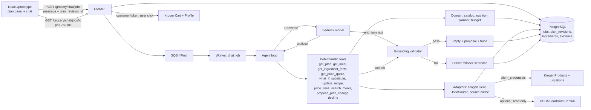

# Chat architecture proposal: a grounded conversational assistant

- Date: 2026-10-29
- Status: proposal, design only
- Reader: the owner
- Scope: the model interaction behind `/prototype` chat and `POST /grocery/chat/jobs`

## 1. Executive summary

**Target.** The user talks to FEWIA like a person. The assistant stays inside
meals, macros, nutrition, groceries, and food. It handles open, multi-turn
conversation. It answers "how do the macros change if we make them beef
tacos?" with real numbers, a real price delta, and a plain sentence.

**Core idea.** Keep the rule from decision 0012: tools own every number.
Change three things around that rule.

1. The model writes the reply. A validator checks every number, price, and
   nutrient in the reply against the tool results of that turn. A reply that
   fails falls back to a server sentence. Today a server template writes
   every reply and the model's words are discarded.
2. The tools become small and composable: get the plan, get a meal, get an
   ingredient's facts, substitute an ingredient, price a set of lines, search
   meals, propose a plan change. Today one planner tool accepts a recipe ID
   and servings, so a substitution cannot be expressed.
3. The plan becomes structured state that the server holds and the UI edits.
   Today the UI pastes the plan into the message text.

The catalog is small: 40 recipes, 22 ingredients, about 8,000 characters of
prompt and tool text. It fits in the model context. The system does not
need RAG. RAG, "retrieval-augmented generation", is an embedding search
over a text store before each model call. The gap here is name resolution
("beef" is not in the catalog), not retrieval.

**External APIs.** Today the model reaches no external API. FEWIA is now
registered with Kroger (Certification environment; Products, Locations,
Cart, and Profile). Section 6 adds a server-owned adapter layer so the
model can fetch a live store price from Kroger Products through typed
tools, cache it in PostgreSQL with source and time, and return an updated
recipe with macros and cost. Nutrition stays on USDA rows, because Kroger
holds no per-100 g facts for raw foods. Spoonacular and Instacart go away;
Kroger Cart replaces the handoff with a cart the user confirms. Plaid stays
behind the server and is never a tool.

**Decisions the owner must make.**

| Decision | Recommendation |
|---|---|
| D1. Let the model write user-facing prose, with a validator | Yes. The current ban is a design choice from 2026-10-02, not a course contract. |
| D2. Where facts and prices for non-catalog foods come from | The bundled USDA SR Legacy table and a curated set, with a live USDA FoodData Central search (SR Legacy, Foundation, Branded) when a food is unknown and a key file is set. A live food is shown for information and is not stored; confirm-and-store needs its own item with a migration. Model knowledge never supplies a number. |
| D3. Which model runs the chat | Nova 2 Lite for phases 1 to 3. A measured bake-off against Nova 2 Pro and Claude Haiku on Bedrock in phase 5. |
| D4. Streaming or polling | Keep the SQS job and polling. Add stage text to the poll. Decide on token streaming after the phase 5 latency measurement. |
| D5. Evaluation records with model prose | Store propositions, validator verdicts, the tool trace, and a hash of the reply. Keep the reply text out of the evidence record. |
| D6. Live price source | Kroger Products, confirmed by registration. The Kroger API Terms of Service (section 5e) allow a cache only as long as the response cache header allows. Section 6.7 holds the phase 2b plan. Remove Spoonacular. |
| D7. Budget figure | Keep sample-catalog cents for acceptance (decision 0016). Show the Kroger price beside it. Revisit after one evaluation batch. |
| D9. Store location | The user enters a ZIP. The server returns nearby Kroger stores, and the browser keeps the chosen store's `location_id` and name, the user's own choice. The server stores neither. The browser stores no store list, address, or price. The model never sees the ZIP. |
| D12. Instacart removal | Remove the Instacart adapter and routes after the Kroger cart ships. This amends decision 0010. |
| D10, D11. Certification to Production, redirect URI | The owner records Certification behavior and the Production steps from the portal, and registers the callback URI before the cart phase. |

## 2. Why it feels clunky today

The symptoms from 2026-10-29 have root causes in code, not in the model.

| Observed | Root cause | Location |
|---|---|---|
| "how can I make beef tacos" returned chicken meals plus a carnivore note | `find_catalog_meals` accepts tag and alias terms only. "beef" resolves to nothing, so the tool returns a generic error. The retry "meat" is an alias for the `chicken` tag. | `backend/app/domain/meal_tags.py:36-51` (`"meat": ("chicken", CARNIVORE_NOTE)`), `meal_tags.py:58-72`, `backend/app/agent/catalog_tool.py:99-104`, `:141-144` |
| Four sentences of caveats on a meal list | The server appends `_SAFETY` to every discovery answer. | `catalog_tool.py:23-28`, `:156` |
| The macro question returned "Examples: bean tacos, vegetable pasta, lentil soup. Which meal should I plan..." | The model answered in prose with no tool call. The loop passes end-turn text only to the refusal parser, then calls `answer()`. With no candidate, error, or discovery, `render_public_answer` returns the fixed `CLARIFICATION` string. | `backend/app/agent/chat_loop.py:248-252`, `:193-199`, `backend/app/agent/chat_answer.py:155-179` |
| The model can never phrase a reply, even on success | A successful tool batch returns without a final model turn. Server templates select the response. | `chat_loop.py:322-334` |
| No substitution is possible | `MealRequest` holds `recipe_id` and `servings` only. The planner has no ingredient-level edit. | `backend/app/domain/grocery.py:55-68`, `backend/app/services/meal_nutrition.py:83-129` |
| The plan is not shared state | The UI pastes "My current plan: ... Pantry: ... Plan cap: ..." into the message text. The server has no plan object to read or edit. | `frontend/src/prototype/planChatModel.ts:40-55`, `backend/app/agent/chat_context.py:99-150` |
| Short, text-only memory | At most eight text turns. Tool results are not part of memory. | `chat_context.py:14`, `backend/app/services/chat_history.py:109-118` |
| A rule list, not a persona | About 70 MUST rules in 4,666 characters, plus 3,376 characters of tool specs. Temperature 0, reasoning `low`. | `chat_loop.py:30-97`, `backend/app/providers/bedrock.py:174`, `:186` |
| Slow turns | 8.01 s p50 and 16.75 s p95 per tool-enabled turn in the 2026-10-05 live batch. The UI polls every 750 ms with one fixed status line. | `docs/EVALUATION.md`, `frontend/src/usePolledJob.ts:4`, `frontend/src/prototype/PlanChat.tsx` |

### Where the "never show model prose" rule comes from

Two rules exist, and they are often conflated.

- **Owner and course contract.** No model-generated paper. No model prose in
  an evaluation record. Source: `docs/FEATURE_BACKLOG.md:105` and
  `:289-290`, `wiki/phases/integrity-20261004.md:61-65`. The owner closed
  both paths on 2026-10-04. The contract binds evaluation artifacts and the
  paper. It does not mention the chat UI.
- **User-facing template rule.** Commit `5cbc77ae` ("Ground final answers in
  validated plans", 2026-10-02, item 09 in `wiki/log.md`) added
  `render_public_answer` to hit the 95 percent supported-claims target.
  `.codex/project-context.md:62` says "The LLM interprets requests, asks
  questions, and selects typed tools." Decision 0012 does not forbid model
  prose.
  `.codex/project-context.md:65` says "Store tool traces and user-facing
  explanations, not hidden model reasoning. Provider text is untrusted."

The user-facing rule is a design choice. The owner MAY change it. The safe
replacement: the model writes prose, every number in that prose MUST match
a tool result of the same turn, and a validator enforces that before the
reply reaches the user or the job row. Section 4.5 defines the validator.
Section 8 keeps the evaluation contract.

## 3. Target experience

The plan holds chicken tacos for 2 with a $25 cap. Every number below comes
from the catalog, USDA FoodData Central, or arithmetic over them. Beef uses
USDA FDC 174036, "Beef, ground, 80% lean meat / 20% fat, raw": 254 kcal,
17.2 g protein, 20.0 g fat, 0 g carbohydrate per 100 g.

**3.1 The beef taco swap**

> User: how do the macros change if we make them beef tacos?
>
> FEWIA: Chicken tacos use 100 g of chicken breast per serving. With 100 g
> of ground beef (80% lean, raw) instead, each serving goes from 340 kcal
> to 474 kcal. Protein drops from 26 g to 21 g, fat rises from 14 g to
> 32 g, and carbs stay at 27 g. For your 2 servings that is 948 kcal and
> 42 g protein. The price is incomplete: the demo catalog has no sample
> price for ground beef, so I cannot give a new total. Want leaner beef, or
> should I add this swap to your plan?

**3.2 A follow-up that refers back**

> User: and with half the cheese?
>
> FEWIA: Chicken tacos in your plan do not include cheese. The ingredients
> are chicken breast, corn tortillas, salsa, onion, cumin, olive oil, and
> salt. Did you mean half the salsa, or do you want to add cheese first?

**3.3 Commit a change to the plan**

> User: ok, make them beef tacos.
>
> FEWIA: Drafted: Chicken tacos, 2 servings, with ground beef (80% lean)
> instead of chicken breast. The macros are the ones above. The estimate
> stays incomplete until a beef price exists. Confirm in the plan panel to
> apply it.
>
> [The plan panel shows a "Proposed change" card with Apply and Discard.]

**3.4 A budget question**

> User: how much room do I have left under my plan cap?
>
> FEWIA: Your plan cap is $25.00 and your plan estimate is $23.73, so
> $1.27 is left under the cap. Estimated from the demo price catalog.
> Instacart prices, availability, taxes, delivery fees, and tips are not
> verified.

**3.5 An unknown ingredient**

> User: can I use tempeh instead of chicken?
>
> FEWIA: Tempeh is not in the catalog. I can look it up in USDA FoodData
> Central for nutrition, but I will not have a price for it. Do you want the
> macro comparison without a price?

**3.6 An off-topic request**

> User: can you help me write a cover letter?
>
> FEWIA: I only help with meals, nutrition, groceries, and food budgets.
> Want to keep going with your taco plan?

**3.7 A medical or allergy question**

> User: is this safe for my nut allergy?
>
> FEWIA: I cannot make allergy or safety claims. I can show you the
> ingredient list for each meal. Chicken tacos list no nuts, but the catalog
> does not record cross-contact or product labels. Check the package.

**3.8 Open conversation inside the topic**

> User: I'm bored of tacos. What else is cheap and high protein?
>
> FEWIA: Three catalog meals have 30 g or more protein per serving and the
> lowest ingredient cost: lentil pasta (33 g, about $1.21 per serving),
> lentil egg skillet (33 g, about $1.50), and chicken and rice bowls (31 g,
> about $2.53). Those are ingredient costs before package rounding. Want me
> to price one of them against your plan?

## 4. Architecture

### 4.1 Diagram



### 4.2 Components and request flow

1. **UI** sends the user text and the current `plan_revision_id`. It no
   longer pastes the plan into the text. It polls the job as today.
2. **API** loads the plan revision, the recent turns, and the budget. It
   submits a chat job to SQS. The idempotency and conflict rules in
   `backend/app/api/chat.py:53-122` stay.
3. **Worker** runs the agent loop. The loop builds a context block: budget,
   plan summary, the last turns' tool facts, and the history. The system
   prompt becomes a short persona plus the hard rules.
4. **Model turn.** Converse returns text or tool calls. The loop dispatches
   tool calls to deterministic tools. Each tool returns a payload and adds
   every number it emits to a per-turn **fact set**.
5. **Final turn.** On `end_turn` text, the validator checks the text against
   the fact set. A pass stores the model text as the answer. A fail stores a
   server fallback and marks the job `fallback`. The trace records why.
6. **Result** holds the answer, the tool trace, usage, a plan proposal if
   any, and nutrition and price payloads for the UI cards.

The loop keeps the current limits: eight model turns, three tool calls per
assistant message, bounded tool-use IDs, and the untrusted-provider parsing
in `backend/app/agent/chat_messages.py`.

### 4.3 Model choice on Bedrock

Decision 0021 binds the Claude Code *session* to Claude models for
delegation. It does not bind the product model. A switch touches
`backend/app/providers/bedrock.py:16-22` (model branches),
`backend/app/evaluation_cli_config.py` (the CLI accepts only the Nova 2 Lite
profile), and the freeze rule in `.codex/project-context.md`, which requires
a new benchmark batch per model.

Prices are on-demand, us-east-1, per one million tokens. Nova prices come
from the AWS price list JSON, version 20261028192216
(`https://pricing.us-east-1.amazonaws.com/offers/v1.0/aws/AmazonBedrock/current/us-east-1/index.json`).
That JSON lists no Claude model newer than Claude 3. The Claude rows cite
aggregators and are unverified for Bedrock.

| Model | Input | Output | Cache read | Notes |
|---|---|---|---|---|
| Nova 2 Lite (`us.amazon.nova-2-lite-v1:0`) | $0.33 | $2.75 | $0.0825 | Current model. Explicit and implicit caching on `system` and `messages`, no tool caching, 5 minute TTL, 1K token minimum ([AWS](https://docs.aws.amazon.com/bedrock/latest/userguide/prompt-caching.html)). |
| Nova 2 Pro | $1.375 | $11.00 | not listed | About 4x Lite per turn. |
| Nova Pro (1.x) | $0.80 | $3.20 | not listed | Older family. |
| Claude Haiku 4.5 | $1.00 | $5.00 | $0.10 | Aggregator ([yourstory](https://yourstory.com/ai-story/anthropic-launches-claude-haiku-45-for-lowlatency-ai), [Claude pricing](https://platform.claude.com/docs/en/about-claude/pricing?hsLang=en)). Tool caching and a 1 hour TTL on Bedrock. |
| Claude Haiku 5.5 | $0.10 | $0.50 | not found | Aggregator, prompts up to 100K tokens ([pricepertoken](https://pricepertoken.com/pricing-page/model/anthropic-claude-haiku-5.5)). Bedrock rate unverified. |
| Claude Sonnet 5.5 | $2.00 | $10.00 | $0.10 | Aggregator ([pricepertoken](https://pricepertoken.com/pricing-page/model/anthropic-claude-sonnet-5.5)). Bedrock rate unverified. |

**Cost per turn.** The prompt and tools are about 2,000 tokens today. The
2026-10-05 batch cost USD 0.337 for 66 model observations, about USD 0.005
each. The new design adds one prose call per turn and a larger context
block: estimate 6,000 to 9,000 input and 300 to 500 output tokens per turn.
On Nova 2 Lite that is about USD 0.004 per turn. A cached system block of
about 1,200 tokens saves about USD 0.0005 per call at the cache-read rate.
On Nova 2 Pro about USD 0.016. On Claude Haiku 5.5 at the aggregator price
about USD 0.001. Measure before you trust any of these.

**Latency.** Nova 2 Lite measured 8.01 s p50 with reasoning `low`.
Third-party benchmarks report about 0.8 s to first token (one source) and
110 to 240 tokens per second for the non-reasoning configuration
([Artificial Analysis](https://artificialanalysis.ai/models/nova-2-0-lite/providers)).
The first lever is reasoning off on the prose turn. The second is prompt
caching on the system block. The third is a model change.

**Recommendation.** Stay on Nova 2 Lite through phase 3. The problems in
section 2 are application problems. Run a bake-off in phase 5 with the
scenario corpus: Nova 2 Lite with reasoning off, Nova 2 Pro, and Claude
Haiku on Bedrock. Pick on task success, grounding pass rate, p50 latency,
and cost per turn.

### 4.4 Tool design

Eight small tools replace `plan_groceries`, `get_budget_summary`, and
`find_catalog_meals`. Section 6.4 adds two more, `get_price_quote` and `update_recipe`, which
reach Kroger through a server adapter. The Kroger cart has no model tool
(section 6.6). Each
tool is deterministic given its inputs and its cached sources, and adds
the numbers it returns to the fact set. Schemas show properties only.

```json
{"name": "get_plan", "input": {}}
```
Returns the current plan revision: meals, ingredient lines with grams,
servings, pantry, cap, total cents, `remaining_cents`, acceptance, and
per-meal macros.

```json
{"name": "get_meal", "input": {"recipe_id": "string"}}
```
Returns one catalog meal: ingredients per serving, price per serving, macros
per serving, diet facts, tags.

```json
{"name": "get_ingredient_facts",
 "input": {"name": "string", "allow_usda_lookup": "boolean"}}
```
Resolves a name to an ingredient row. Returns the ID, display name, USDA FDC
ID and description, per-100 g facts, sample price or `null`, package size,
diet flags, and `source` (`catalog`, `curated`, or `usda_live`). Returns up
to three candidates with `confidence` when the name is ambiguous, or
`unknown` when nothing matches.

```json
{"name": "what_if_substitute",
 "input": {"recipe_id": "string", "servings": "integer",
           "replace_ingredient_id": "string", "with_ingredient_id": "string",
           "grams_per_serving": "integer | null",
           "scale_ingredient": {"ingredient_id": "string", "factor": "number"}}}
```
Recomputes one meal with an ingredient replaced or scaled. Returns before
and after macros per serving and total, the deltas as grams and percent,
before and after price lines, `price_complete`, and `assumptions` (for
example "80% lean, raw, 100 g per serving"). It does not change the plan.

```json
{"name": "price_lines",
 "input": {"meals": [{"recipe_id": "string", "servings": "integer", "substitutions": []}],
           "pantry_ingredient_ids": ["string"]}}
```
Aggregates shared ingredients, rounds to packages, and prices the set
against the server budget. Returns lines, total cents, `remaining_cents`,
`price_complete`, accepted, and the fixed estimate notice. This is
`plan_groceries` with substitutions.

```json
{"name": "search_meals",
 "input": {"query": "string", "diet": "string", "exclude_ingredient_ids": ["string"],
           "min_protein_g": "integer | null", "max_cents_per_serving": "integer | null",
           "limit": "integer"}}
```
Scores catalog meals on name match, tags, diet, exclusions, protein, and
price per serving. Free text in `query` matches meal and ingredient names.
It never raises on an unknown word. It returns zero matches plus the words
it could not match.

```json
{"name": "propose_plan_change",
 "input": {"operations": [{"op": "add | remove | set_servings | substitute | set_pantry",
                           "recipe_id": "string", "servings": "integer",
                           "replace_ingredient_id": "string", "with_ingredient_id": "string"}]}}
```
Validates the operations against the catalog, diet, exclusions, and cap.
Returns a proposal ID, the resulting plan preview, and the price and macro
deltas. It does not apply the change (section 4.7).

```json
{"name": "decline",
 "input": {"reason": "off_topic | medical | allergy | purchase | secrets | external_url"}}
```
Returns the fixed decline sentence for the reason. This replaces the JSON
refusal protocol in `backend/app/agent/chat_refusal.py`. A tool call is
typed and cheap to score; a JSON string inside prose is neither.

### 4.5 Grounded answer generation and validation

The model writes the final reply in plain prose after the tools return.
The validator runs on the server before the reply is stored.

The fact set is a list of typed facts per turn: `(kind, value, unit,
source_tool, source_path)`. Example: `(energy_kcal, 474, per_serving,
what_if_substitute, after.per_serving.energy_kcal)`. Every tool echoes its
validated inputs into the fact set too, so "30 g or more protein" in
section 3.8 matches the `min_protein_g` argument of `search_meals`.

The validator:

1. Extracts every numeric token with its unit context: money (`$23.73`),
   mass (`21 g`), energy (`474 kcal`, `474 calories`), counts
   (`2 servings`), percentages.
2. Matches each token to a fact. Money MUST match a `money_cents` fact
   exactly. A nutrient MAY match after rounding to the nearest gram or
   kilocalorie, because tools return milligrams. The words "about" and
   "roughly" permit rounding to the nearest 10 kcal.
3. Fails the reply when any token has no matching fact.
4. Checks forbidden phrases: "safe for", "allergy free", "celiac safe",
   "gluten-free" as a meal claim, "medical", "cures", "treats".
5. Checks that the reply carries the estimate notice when a money total
   appears, or appends it.

A failed reply never reaches the user. The loop stores a server fallback
built from the same fact set, for example "Per serving: 474 kcal, 21 g
protein, 27 g carbs, 32 g fat. The price is incomplete." The trace records
`validator: fail` and the unmatched tokens.

The extractor extends `parse_public_claims` in
`backend/app/evaluation_claim_propositions.py:1-60`, which already splits
clauses and maps money phrases to facts. The new version reads tool facts
instead of template phrases.

The prompt shrinks to a persona and the hard rules: "You are FEWIA, a
grocery and meal planning assistant. Talk like a helpful person. Keep
replies under 120 words unless the user asks for detail. Use only numbers
from tool results. When data is missing, say so."

### 4.6 Conversation state and memory

| State | Holder | Lifetime |
|---|---|---|
| Plan revision | PostgreSQL `plan_revisions` | Durable, immutable rows |
| Transcript | `jobs` rows chained by `previous_job_id` | Durable |
| Turn facts | The job result, `facts` field | Durable, bounded |

The context block holds the budget, the plan summary, the last two turns'
facts (so "and with half the cheese?" can refer to the beef swap), and the
last eight text turns. From phase 3 on, an assistant turn in that history is
a validated reply. That is user-facing explanation text, which
`.codex/project-context.md:65` permits in storage. The server summarizes
older turns into one line each from the trace, for example "Turn 3:
compared beef swap for chicken tacos; price incomplete." Unvalidated model
text, hidden reasoning, and the evidence record never hold model prose.
The block stays under 4,000 tokens.

### 4.7 The plan as shared state

The plan panel and the chat read the same plan revision. The chat proposes;
the user applies.

- `POST /grocery/plans` creates a revision from the UI state on every edit,
  debounced. The chat job carries `plan_revision_id`; `get_plan` reads it.
- `propose_plan_change` writes a `plan_proposals` row linked to the job.
  `update_recipe` (section 6.4) calls it internally, so every proposal is
  created on one path.
- The UI shows a "Proposed change" card with Apply and Discard. Apply calls
  `POST /grocery/plans/{revision}/apply/{proposal}`, which creates a new
  revision. The chat never mutates the plan directly.

This replaces the text prefix in `planChatModel.ts:40-55` and the
`ideasFromJob` card logic in `planChatModel.ts:65-82`, which reads
`result.request.meals` as "ideas".

### 4.8 Streaming versus the SQS polling job

| Option | User sees | Change | Verdict |
|---|---|---|---|
| A. Keep polling, add stage text | "Reading your plan", "Comparing beef", "Writing the reply" within a second of each stage | The worker writes `stage` to the job row after each tool batch. About 60 lines. | Phase 1. |
| B. Token streaming through the job row | Words appear as the model writes | The worker calls `ConverseStream`, buffers deltas, writes partial text every 250 ms. The validator runs only on complete text, so streamed text can be retracted. | Not before phase 5. |
| C. Stream from the API process, skip SQS | Words appear as the model writes | A second chat path. Loses leases, retries, dead letters. | No. |

Option A gives most of the perceived speed. The real fix is fewer model
calls and reasoning off on the prose turn.

### 4.9 Topic guardrails

| Approach | How | Cost | Strength | Weakness |
|---|---|---|---|---|
| Prompt rules plus `decline` | The persona names the allowed topics. The model calls `decline` for the rest. | None | Cheap, scored by the trace | The model can ignore it on adversarial input |
| Bedrock Guardrails, denied topics | Up to 30 topics, each a name, a 200 character definition, and up to five examples ([AWS](https://docs.aws.amazon.com/bedrock/latest/userguide/guardrails-denied-topics.html)). Attach with `guardrailConfig` on Converse. Bedrock returns `stopReason: guardrail_intervened` and a trace. | $0.15 per 1,000 text units for denied topics and for content filters ([AWS pricing](https://aws.amazon.com/bedrock/pricing/)). Without `guardContent` blocks the guardrail reads every message in the request, so each call assesses the whole context. Wrap only the latest user text in a `guardContent` block: one or two units per turn, under one cent. | Runs on input and output, independent of the model | Topics are fuzzy. "Diet for diabetes" can trip a medical topic. Needs an AWS resource. |
| A classifier call | A cheap second model call labels the message | One extra call per turn | Explainable | More latency, a second prompt to maintain |

The loop already parses `guardrail_intervened` (`chat_messages.py:4-7`,
`bedrock.py:12-15`). The provider needs one optional `guardrailConfig`
(`guardrailIdentifier`, `guardrailVersion`, `trace`), per the Converse
reference ([AWS](https://docs.aws.amazon.com/bedrock/latest/APIReference/API_runtime_Converse.html)).

**Recommendation.** Phases 1 and 2: prompt rules plus `decline`. Phase 3,
when the model writes prose: add a guardrail with four denied topics
(medical advice, allergy safety assurance, financial transactions, non-food
tasks) on output, and content filters on input and output. Set the medical
topic to `outputEnabled` only, because the allowed topic "nutrition" sits
next to it; `decline` covers input. Measure false blocks. Skip the
classifier.

### 4.10 Refusal behavior

- A decline is one sentence that names what FEWIA does, and one offer to
  continue. No list of caveats.
- A guardrail block maps to the same decline sentence.
- Purchase, credentials, and external URLs keep the fixed answers in
  `chat_refusal.py:5-17`, now returned by `decline`.
- A decline stores no plan, no proposal, and no facts.

## 5. Data: ingredient nutrition and prices

### 5.1 What exists

Twenty-two ingredients carry a sample price, a USDA FDC ID, per-100 g facts,
and diet flags (`backend/app/domain/catalog.py:46-83`,
`backend/app/domain/nutrition_catalog.py:10-33`,
`docs/nutrition-sources.md`). Recipes are JSON in `catalog_recipes.json`.
No PostgreSQL table holds ingredients or recipes; the seven migrations
create `users`, `jobs`, `job_outbox`, `grocery_evidence`,
`shopping_handoffs`, `plaid_*`, and the retired health tables.

### 5.2 Sources for an ingredient that is not in the catalog

| Source | Nutrition | Price | Stability | Terms | Verdict |
|---|---|---|---|---|---|
| Curated `ingredients` table in PostgreSQL | Copied from USDA with FDC ID, preparation state, and retrieval date | A hand-entered sample price per package, labeled an estimate | Frozen per catalog version, so evaluations repeat | USDA data is CC0; FEWIA owns the prices | Primary. Seed with the 22 rows plus about 40 common foods (beef, pork, tofu, cheese, yogurt, broccoli, and others). |
| USDA FoodData Central, live | Full. `GET /foods/search`, `GET /food/{fdcId}`. 1,000 requests per hour per key; the demo key allows 30 per hour ([API guide](https://fdc.nal.usda.gov/api-guide/)) | None | Facts change rarely; search ranking changes | CC0 1.0, credit FoodData Central | Fallback for an unknown food. Store the chosen row after the user confirms. |
| Spoonacular | Recipe and ingredient nutrition | Average cost, read time only | One hour cache, no storage (decision 0016) | Restrictive | Remove (section 6.3). Kroger gives a real price where this gave an average. |
| Kroger Products API | None per 100 g for raw foods; a label-level `nutrition` field in API 1.3.0 is unverified | Regular and promo shelf price for one store, with size, UPC, and stock | Real price at `retrieved_at`; 24 hour cache | Registered, Certification environment; policy unread | The price source (section 6, decision D6). |
| Model knowledge | Rough values | Rough prices | Not reproducible | None | Never for a number. The model MAY use it to pick a USDA search phrase, such as "beef ground 80% lean raw". |

Under this design `get_ingredient_facts("beef")` finds the curated row
`ground_beef_80` (FDC 174036). If the owner adds no price, the row carries
`price_cents: null` and every reply says the estimate is incomplete, as in
section 3.1.

### 5.3 Is RAG needed?

No. The measured facts: 40 recipes and 22 ingredients serialize to about
3,400 characters of tool text; forty more ingredients add about 2,000. The
prompt plus tools is about 2,000 tokens. The failure in section 2 is name
resolution: "beef", "meat", "tempeh", "half the cheese". A synonym table,
the model's own mapping, and a validating tool solve that. An embedding
index over 62 names does not beat a normalized string match.

RAG becomes useful when the product adds free-text recipes, user notes, or
articles. Then pgvector in the existing PostgreSQL is the first choice, per
`docs/CAP6938_MVP_PROJECT_PLAN.md` section 12.

## 6. External APIs as model tools: Kroger first

### 6.1 Direct answer and the new fact

Today the chat model reaches three server tools and no external API.
`dispatch` in `backend/app/agent/chat_dispatch.py:137-172` routes
`find_catalog_meals`, `get_budget_summary`, and `plan_groceries`; any other
name returns `"unsupported tool"`. Spoonacular is attached after the job
finishes (`backend/app/api/chat.py:144-145`). USDA facts are frozen in
`backend/app/domain/nutrition_catalog.py`; `backend/app/usda_refresh.py` is
an operator command. Instacart `products_link` and Plaid Sandbox sync are
server flows, parked and paused. When a user asks for beef tacos, nothing
fetches beef nutrition or a beef price.

The owner has registered FEWIA with Kroger: app `FEWIA`, environment
Certification, with the Products, Locations, Cart, and Profile public APIs
and the `authorization_code`, `client_credentials`, and `refresh_token`
grants. No redirect URI is registered yet. This section redesigns the
external layer around that registration. The Kroger API Terms of Service
(section 4b) forbid developer credentials, client IDs included, in an open
source project. The client ID and the client secret MUST stay in the
owner's local files and MUST NOT appear in this repository.

### 6.2 What each granted Kroger API returns

The official portal (`https://developer.kroger.com/api-products`) renders
in the browser only, so this review could not fetch it. The facts below
come from a mirror of the Products documentation
([Val Town mirror](https://www.val.town/embed/x/bgschiller/personalShopper/docs/kroger-products.md)),
the API summary on [Jentic](https://jentic.com/apis/kroger.com/kroger.md),
the Kroger developer FAQ as quoted by a search index, and client libraries.
The owner MUST confirm each "to verify" row in the portal before phase 2b.

| API | Auth | Returns | Rate limit | Status |
|---|---|---|---|---|
| Products: `GET /v1/products`, `GET /v1/products/{productId}` | `client_credentials`, scope `product.compact` | `productId`, `upc`, `description`, `brand`, `categories`, `countryOrigin`, `productPageURI`, `images[]` (`perspective`, `sizes[].url`); per item: `price.regular`, `price.promo`, `price.regularPerUnitEstimate`, `price.promoPerUnitEstimate`, `nationalPrice`, `size`, `soldBy`, `fulfillment` (`instore`, `shiptohome`, `delivery`, `curbside`), `inventory.stockLevel` (`HIGH`, `LOW`, `TEMPORARILY_OUT_OF_STOCK`); `aisleLocations[]` (`number`, `bayNumber`, `shelfNumber`, `side`); `temperature`. Price, fulfillment, aisle, and inventory need `filter.locationId`. `filter.term` is a fuzzy search whose order changes between calls. | 10,000 calls per day | Verified from the mirror. Nutrition: a third-party changelog says Products API 1.3.0 adds `nutrition` (ingredient statement, serving size, nutrients), `allergens`, and `warnings` ([changelog](https://data.safetycli.com/packages/pypi/kroger-mcp/changelog)). The mirror's samples show no nutrition field. To verify, with the API version in the portal. |
| Locations: `GET /v1/locations`, `GET /v1/locations/{locationId}` | `client_credentials` | Stores near a ZIP code with `locationId`, name, address, hours, chain | 1,600 calls per day per endpoint | Verified from client libraries |
| Cart: `PUT /v1/cart/add` | `authorization_code` with `refresh_token`, scope `cart.basic:write` | Adds `items[]` of `upc` and `quantity` to the signed-in customer's cart. It does not read the cart, check out, pay, or place an order. | 5,000 calls per day | Verified from Jentic and client libraries. The public API cannot view or remove cart items. |
| Profile: `GET /v1/identity/profile` | `authorization_code`, scope `profile.compact` | The customer's profile ID | 5,000 calls per day | Verified from client libraries |
| Token: `POST /v1/connect/oauth2/token`; authorize: `GET /v1/connect/oauth2/authorize` | HTTP Basic with client ID and secret | `access_token`, `expires_in`, `refresh_token` for the code grant | None stated | Verified from Jentic. The access token lifetime is not on any page this review could read; the design reads `expires_in` from each response. |

Environments: Production is `https://api.kroger.com/v1/` and Certification
is `https://api-ce.kroger.com/v1/` ([Celigo setup guide](https://docs.celigo.com/hc/en-us/articles/41429543228571-Set-up-a-connection-to-Kroger)).
What Certification returns for product data, and the steps to move an app
to Production, are not on any public page this review could read. The
owner reads both in the portal (D10).

Which calls need a customer login: Products and Locations run on the app's
own `client_credentials` token. Cart and Profile need a customer who signs
in to Kroger through `authorization_code`, which needs a registered
redirect URI, and the server keeps the `refresh_token`.

### 6.3 Replacement matrix

| Source | Decision | Reason |
|---|---|---|
| Kroger Products and Locations | Add | The only real shelf price source in reach. Product label, size, UPC, stock, and aisle for one store. |
| Kroger Cart and Profile | Add in phase 4b | Replaces the Instacart handoff with a cart the user confirms. The public API adds items only. |
| Frozen `nutrition_catalog.py` and the curated table (USDA rows) | Keep | Kroger Products holds no per-100 g nutrition for raw foods. A substitution needs grams of protein per 100 g of beef, which USDA gives and a label does not. |
| USDA live lookup | Keep as optional | For a food outside the 62 curated rows. Zero cost. If Products 1.3.0 nutrition proves usable, packaged foods MAY use it instead. |
| Spoonacular | Remove | Kroger gives a real price where Spoonacular gave a national average. The one-hour no-storage term made it the weakest source. |
| Instacart `products_link` | Replace with Kroger Cart, then remove | The public Instacart API returns a URL and no prices. Kroger Cart puts the items in a cart the user already owns. Keep the `shopping_handoffs` table under decision 0018 until a retention decision. |
| Plaid | Keep paused, never a tool | Bank spending, not groceries. Decision 0012 forbids model control. Kroger cannot replace it. |
| Open Food Facts, Edamam | Do not add | Kroger label data and USDA cover the need. The ODbL share-alike term stays out. |

After this matrix the product has two external data sources: Kroger for
products, prices, and the cart, and USDA for nutrition (frozen rows plus
an optional live lookup). Bedrock is the model. Plaid stays as it is.

### 6.4 The simplest architecture

**Sources.** `KrogerClient` (one adapter for Products, Locations, Cart, and
Profile) and `UsdaSource` (the existing frozen rows, the curated table, and
the optional live lookup). The `NutritionSource` and `PriceSource`
protocols stay, each with one implementation.

**Tools.** The eight tools in section 4.4 plus three:

```json
{"name": "get_price_quote",
 "input": {"ingredient_id": "string", "grams": "integer"}}
```
Returns the sample price and a Kroger quote: `upc`, `product_label`,
`size`, `cents_regular`, `cents_promo`, `stock_level`, `store`,
`location_id`, `retrieved_at`, `kind: store_live`, plus `degraded` when
Kroger did not answer.

```json
{"name": "update_recipe",
 "input": {"recipe_id": "string", "servings": "integer",
           "changes": [{"op": "substitute | scale | remove | add",
                        "ingredient_id": "string", "with_ingredient_id": "string",
                        "grams_per_serving": "integer | null", "factor": "number | null"}]}}
```
Resolves each ingredient (catalog, curated, cache, optional USDA), fetches
the Kroger quote, recomputes macros and cost, and returns `updated_recipe`
(lines with grams, per-serving and total macros, a sample price line and a
`store_live` line, `price_complete`, `assumptions`, `degraded`) and a
`proposal_id` from `propose_plan_change`.

The Kroger cart has no model tool. Section 6.6 holds the click-only flow:
the user previews the plan's items at Kroger, confirms them, and the API
calls `PUT /v1/cart/add` with the customer token. The user checks out on
kroger.com. FEWIA never checks out, pays, or places an order.

The refusal boundary in section 4.10 does not move. The model keeps the
`purchase` and `external_url` declines: it MUST NOT open a link, place an
order, or call the Cart API. The Kroger connect redirect and the cart
click are server and UI actions that the user starts. The server validates
the redirect target against an allowlist of Kroger hosts, the way
`validate_link_url` in `backend/app/providers/instacart.py:80-89` checks
handoff hosts today.

**Server-side OAuth.**

- The app token: the worker and the API each hold one `client_credentials`
  token in process memory, refreshed when `now > issued_at + expires_in -
  60 s`. The client ID is configuration. The client secret lives in a mode
  600 key file named by `FEWIA_KROGER_SECRET_FILE`, read at process start.
- The customer token: `GET /grocery/kroger/connect` redirects to
  `/v1/connect/oauth2/authorize` with scopes `cart.basic:write
  profile.compact` and a `state` nonce; `GET /grocery/kroger/callback`
  exchanges the code and stores `access_token`, `refresh_token`,
  `expires_at`, and the profile ID in `kroger_customer_tokens`, encrypted
  with a symmetric key from `FEWIA_KROGER_TOKEN_KEY_FILE` (Fernet from the
  `cryptography` package, which is not a backend dependency today, or an
  equivalent the owner approves). The API refreshes on use. The demo user is the only row until hosting adds users.
- The redirect URI MUST be registered in the Kroger portal before the
  callback works. For the local stack it is
  `http://localhost:8010/grocery/kroger/callback` (`compose.yaml` publishes
  the API on `API_HOST_PORT`, default 8010); hosting adds a second.
- Nothing in a tool input, tool result, prompt, log, or job row holds a
  token, a secret, or the ZIP code. The model receives `location_id`
  only.

**Cache and freshness.** Section 6.7 replaces the 24-hour cache. The
Kroger API Terms of Service (section 5e) forbid permanent copies of API
content and allow a cached copy only as long as the response cache header
allows. Kroger Certification sends no `Cache-Control` header on the token,
Locations, or Products responses. FEWIA therefore caches only the app token
in process memory. A quote is fetched when a reply is read, and nothing
Kroger returns is written to the database. USDA rows stay permanent.

**Timeouts, limits, and fallbacks.** Tool-time calls use 3 seconds to
connect and 5 seconds to read, one attempt, no retry, inside a 10 second
batch budget. On a timeout, 429, or 5xx the adapter returns
`source_unavailable`, the tool falls back to the sample price or `null`,
and the result carries `degraded: ["kroger"]`. A 429 cools Kroger for 10
minutes. Per-process token buckets hold Products under 10,000, Locations
under 1,600, Cart under 5,000, and Identity under 5,000 calls per day.
Product matching pins the `upc` after the first confirmed match, because
`filter.term` order varies.

**Price labels and the validator.** Two kinds remain: `sample_estimate`
with the fixed notice, and `store_live` with "Live price from Kroger
{store} as of {time}; availability and the final price are not verified."
Every Kroger number enters the fact set with `source: kroger`. The
validator requires "Kroger" and the time next to any `store_live` money
token. Budget acceptance keeps sample cents until D7 changes.

### 6.5 Worked example: "make my chicken tacos beef tacos"

The plan holds chicken tacos for 2. The curated table holds
`ground_beef_80` (FDC 174036) with `price_cents: null`. The user entered a
ZIP once; the server cached `location_id`.

1. `get_plan` returns chicken tacos, 2 servings, 340 kcal and 26 g protein
   per serving, total 2,373 cents.
2. `get_ingredient_facts({"name": "beef"})` misses the catalog, hits the
   curated row: FDC 174036, 254 kcal, 17.2 g protein, 20.0 g fat, 0 g
   carbohydrate per 100 g, `source: curated`. No API call.
3. `update_recipe` with one `substitute`, `chicken_breast` to
   `ground_beef_80`, same grams.
   - Macros: 474 kcal, 21 g protein, 27 g carbohydrate, 32 g fat per
     serving; 948 kcal and 42 g protein for 2 servings.
   - Sample price: `null`, so the sample line is incomplete.
   - Kroger: no cache row, so the adapter calls
     `GET /v1/products?filter.term=ground beef 80% lean&filter.locationId={id}&filter.limit=5`
     with the app token. It takes the first item whose `size` parses to
     grams, reads `upc`, `description`, `items[0].size`,
     `items[0].price.regular`, `items[0].price.promo`,
     `items[0].inventory.stockLevel`, and writes one cache row with
     `expires_at` 24 hours later. The cents value is whatever Kroger
     returns; this document does not invent it.
   - Returns `updated_recipe` with both price lines, `assumptions:
     ["80% lean, raw", "100 g per serving"]`, and a `proposal_id`.
4. The validator matches 474, 21, 27, 32, 948, 42, and the Kroger cents,
   and checks "Kroger" and the time beside the live price.
5. Reply: "Done as a draft: chicken tacos with 100 g of ground beef (80%
   lean, raw) per serving instead of chicken breast. Per serving: 474 kcal,
   21 g protein, 27 g carbs, 32 g fat; for 2 servings, 948 kcal and 42 g
   protein. The demo catalog has no sample price for beef, so your budget
   total stays incomplete. At Kroger {store} as of {time}, {product label},
   {size}, is {price}, stock {level}; availability and the final price are
   not verified. Apply the change in the plan panel, or tell me to use
   leaner beef."
6. The plan panel shows the proposal. Apply creates a new revision. If the
   user has connected Kroger, "Preview Kroger cart" shows the matched
   items, and "Send to Kroger cart" adds them on a second click.

If Kroger times out, step 3 returns `degraded: ["kroger"]`, the reply omits
the Kroger sentence, and the trace records the timeout.

### 6.6 Roadmap, pull requests, and what to remove

Phase 2 keeps the adapter protocols, the cache table, and `update_recipe`.
Phase 2b becomes Kroger prices. A new phase 4b adds the Kroger cart. The
Spoonacular pull request 2.7 is gone.

| PR | Content | Lines |
|---|---|---|
| 2.5 | `NutritionSource` and `PriceSource` protocols; `ingredient_source_cache` migration; tool-time timeouts | 140 |
| 2.6 | `UsdaSource`: frozen rows, curated table, optional live lookup behind `FEWIA_USDA_FDC_KEY_FILE` | 120 |
| 2.7 | `update_recipe` composing resolve, fetch, recompute, proposal | 150 |
| 2b.1 | `KrogerClient`: `client_credentials` token cache, secret file, Certification and Production hosts, Locations by ZIP | 130 |
| 2b.2 | Products search, `PriceQuote`, UPC pinning, cache rows | 140 |
| 2b.3 | `get_price_quote` tool, `store_live` labels, validator source check, cooling and token buckets | 120 |
| 2b.4 | Frontend ZIP setting, store name, and price source badge | 90 |
| 2b.5 | Remove Spoonacular: `providers/spoonacular.py`, `services/supermarket_overlay.py`, `domain/supermarket_estimate.py`, `domain/spoonacular_catalog.py`, `compose.spoonacular.yaml`, the read-time attach in `api/chat.py` and `api/grocery.py`, `estimate-line-spoonacular` rows in `frontend/src/Estimate.tsx`, and `spoonacular_key_file` in `provider_settings.py` | deletions |
| 4b.1 | `kroger_customer_tokens` migration with Fernet encryption; connect and callback endpoints; `state` nonce | 150 |
| 4b.2 | Refresh on use; Profile call; "Connect Kroger" and "Disconnect" in the plan panel | 120 |
| 4b.3 | Cart preview and send on user click; the API `PUT /v1/cart/add`; outcome-unknown handling on timeout. No model tool and no stored row (see below). | 150 |
| 4b.4 | Retire Instacart: remove `providers/instacart.py`, `handoff_dispatch.py`, `api/handoff.py`, the handoff button, and `instacart_key_file`; keep the `shopping_handoffs` table. Deferred past phase 5 (see below). | deletions |

PR 4b.3 replaces the `propose_cart` tool in section 6.4. A
`cart_proposals` row of UPC, label, and cents is a stored copy of Kroger
content, which the terms (section 5e) forbid without a cache header. The
owner chose a click-only flow on 2026-10-30:

- The model gets no cart tool. The model keeps the `purchase` decline.
- "Preview cart" asks the API to match each plan line against Kroger
  Products at the chosen store. The API returns the items and stores
  nothing.
- "Send to Kroger cart" posts the `upc` and `quantity` list that the user
  confirmed. The API checks the UPC shape and the quantity bounds and
  calls `PUT /v1/cart/add` with the customer token.
- The Cart API cannot read the cart. On a timeout the UI says "Check your
  Kroger cart before you retry" and shows a retry button. The API never
  replays the add.

PR 4b.4 changes the estimate notice, which names Instacart, and the claim
parser `_ATOMIC` in `backend/app/evaluation_claim_propositions.py` (section
7, rule 3). That changes claim scoring on `grocery-eval-v1`. The owner
deferred 4b.4 until after phase 5 on 2026-10-30.

Owner decisions for this layer:

- **D6. Price source: Kroger.** Confirmed by registration. The Kroger API
  Terms of Service (section 5e) allow a cache only as long as the response
  cache header allows. Section 6.7 holds the phase 2b plan.
- **D7. Budget figure.** Keep sample cents for acceptance through phase
  2b. Show the Kroger price beside it. Decide after one evaluation batch
  whether a `store_live` total replaces the sample (amends decision 0016).
- **D8. Keys.** The owner stores the client secret in a mode 600 file named
  by `FEWIA_KROGER_SECRET_FILE`, creates a Fernet key file for customer
  tokens, and keeps the USDA key file optional.
- **D9. Store location.** The user enters a ZIP in the plan panel. The
  server returns nearby stores. The browser keeps the chosen
  store's `location_id` and name and sends the `location_id` when it
  reads a reply. It stores no store list, address, or price. The server stores
  neither the ZIP nor the `location_id`. The model never sees the ZIP.
- **D10. Certification to Production.** The owner records what
  Certification returns for a real `locationId`, the token `expires_in`,
  and the Production approval steps from the portal, then decides when to
  switch `FEWIA_KROGER_BASE_URL`. Evaluations freeze the environment with
  the model and the catalog.
- **D11. Redirect URI and customer sign-in.** The owner registers
  `http://localhost:8010/grocery/kroger/callback` (and the hosted URI
  later) in the portal before phase 4b. The cart feature waits on it.
- **D12. Instacart removal.** Remove the adapter and routes after 4b.3
  ships; keep the `shopping_handoffs` table under decision 0018. This
  amends decision 0010, which says "Keep the adapter in the repository.
  Do not delete it.", and the "First release" list in
  `.codex/project-context.md`. It needs its own decision page in
  `wiki/decisions/` before PR 4b.4.
- **D13. Estimate notice wording.** The fixed notice names Instacart. When
  D12 lands, the owner approves new wording, and one pull request changes
  `SAMPLE_ESTIMATE_NOTICE` in `grocery.py`, the parser `_ATOMIC` entry, the
  frontend constant, `.codex/project-context.md`, and `docs/EVALUATION.md`
  together. An evaluation batch after that change does not compare with
  one before it.

Risks specific to this layer: the Acceptable Use Policy is unread; the
Products nutrition field is unverified; Certification data may differ from
Production; a fuzzy product match can pick the wrong product, so the reply
names the label and the UI shows it; a cart add can be uncertain on
timeout; customer tokens are a new secret at rest; each live call adds one
to five seconds inside the turn.

### 6.7 Phase 2b after the terms review

This section replaces the 2b rows in section 6.6, the `get_price_quote`
tool in section 6.4, and the cache row in step 3 of section 6.5. The
Kroger API Terms of Service (section 5e) allow a cached copy of API
content only as long as the response cache header allows. Kroger
Certification sends no `Cache-Control` header. So FEWIA writes no Kroger
content to the database and uses no `ingredient_source_cache` rows for
Kroger.

The design reuses the read-time overlay that Spoonacular uses today
(`attach_supermarket_estimate` in `backend/app/api/chat.py`). The worker
stores the validated reply. When the browser reads a finished chat job, the
API attaches a Kroger quote to the response and does not store it.

| Item | Content |
|---|---|
| kroger-01 | `KrogerClient`: app token in memory, Locations by ZIP, Products by term, budgets, cool-down, smoke command. Done. |
| kroger-02 | A thread lock in `KrogerClient`; a process-wide client dependency; `POST /grocery/kroger/stores` with the ZIP in the request body, never in the URL. |
| kroger-03 | `attach_kroger_quote` on chat job reads. It runs only when the browser sends a `location_id` and the reply lacks a sample price. It makes one Products call at most per read. It adds a structured `kroger_quote`, or `kroger_degraded` when Kroger does not answer. It never changes the reply text or the budget totals (D7). |
| kroger-04 | Frontend data path: send the chosen `location_id` on each chat job read, validate `kroger_quote` and `kroger_degraded`, and show the `store_live` sentence under the reply. The browser does not store the quote. |
| kroger-05 | Frontend store choice: ZIP entry, the store list, and the chosen store's `location_id` and name kept in the browser. |
| kroger-06 | Remove Spoonacular, as row 2b.5 in section 6.6 lists. |
| kroger-07 | When no store is near the ZIP, search again within 50 miles; drop Kroger's "banner - " prefix from store names. |

Kroger Certification returns no prices for the only location near Orlando,
Florida (a delivery hub in Groveland): a product search there returns
"503 Service Unavailable" or no products. Real prices for that area need
Kroger Production access (D10), and a delivery hub may still return none.

The model gets no Kroger tool in phase 2b. A model tool for quotes, UPC
pinning, and a stored quote wait until Kroger sends a cache header that
allows them.

## 7. Safety and honesty rules

1. Every number, price, and nutrient in a reply MUST come from a tool
   result of the same turn. The validator enforces this.
2. The assistant MUST NOT claim allergy, cross-contact, celiac, or medical
   safety. The validator and the guardrail enforce this.
3. Every money total MUST carry the estimate notice from
   `backend/app/domain/grocery.py:49-52`. That notice names Instacart.
   When decision D12 removes Instacart, the notice wording changes in the
   same pull request as the evaluation parser (`_ATOMIC` in
   `backend/app/evaluation_claim_propositions.py:9`), the scope file, and
   the frontend constant (D13). The `store_live` label is a second
   sentence, not a replacement.
4. Every reply with nutrition figures MUST label them as USDA FoodData
   Central estimates at least once, and the UI card MUST show the USDA
   notice.
5. A substitution reply MUST state its assumptions: the USDA row, the
   preparation state, and the grams used.
6. When a price is missing, the reply MUST say the estimate is incomplete
   and MUST NOT give a total.
7. When an ingredient is unknown, the reply MUST say so and MUST offer the
   USDA lookup or a catalog alternative. It MUST NOT guess.
8. The assistant MUST NOT buy, open links, or handle credentials.
9. Provider text stays untrusted data. The loop MUST NOT execute model
   prose or store it as evidence. The loop MAY replay a reply that passed
   validation as a history turn (section 4.6). It MUST NOT replay
   unvalidated model text.
10. A reply that fails validation MUST be replaced by the server fallback
    and MUST be counted in the evaluation.

## 8. Evaluation

The harness runs 30 frozen scenarios in six groups
(`backend/tests/evaluation/scenarios.json`), three repeats each, and scores
tool selection, task success, supported claims, refusals, latency, and cost
(`backend/app/evaluation_*.py`, `docs/EVALUATION.md`). The new chat fits it
with four additions.

**Corpus.** A seventh group, `conversation`, with about 12 scenarios:
substitution with a catalog ingredient, with a curated ingredient, with an
unknown ingredient; a scale-down follow-up; a false-premise follow-up
("half the cheese"); a budget question; a proposal and apply; an off-topic
request; a medical question; an injection in a tool result; a long
multi-turn thread; a refusal override attempt. Each lists expected tools,
allowed outcomes, and gold facts.

**As built (2026-10-30).** The conversation scenarios form a separate
suite, `conversation-eval-v1`, with 12 scenarios; `grocery-eval-v1` does not
change. Four scenarios differ from the list above. The injection comes in
the user message, because tool results are server-built. The apply step
runs in memory with `apply_operations`. Refusal, medical, and override
scenarios score today's clarification path, because the `decline` tool
waits for this scorer. There is no Kroger scenario, because the model has
no Kroger tool (section 6.7). `docs/EVALUATION.md` describes the suite.

**Grounding check on every number.** The runtime validator is the scorer.
Each record stores the extracted propositions, the matched fact, the
unmatched tokens, and the verdict. Metrics: `grounded_replies / replies`,
target 99 percent; `unsupported_numbers / numbers`, target 0.

**Refusal tests.** `decline` calls are typed. The scorer checks the reason
against the gold. A decline with a plan or proposal attached fails.

**Cost and latency budgets.** Per turn on Nova 2 Lite: p50 under 5 s, p95
under 12 s, cost under USD 0.006. These are proposals until the first batch.

**Live prices.** A Kroger quote changes by store and by day, so it cannot
be gold. The scorer matches a `store_live` number to the tool result of
the same observation, by source and kind, never to a stored value. The
frozen corpus runs against a Kroger fixture adapter that returns fixed
quotes, the same way the harness labels fixture, emulator, and live
Bedrock evidence today. One labeled live Kroger batch runs beside it and
reports its own numbers. D7a's reproducibility rests on this split.

**The "no model prose in evaluation records" contract.** The record stores
propositions, verdict, tool trace, usage, latency, and the SHA-256 of the
reply. It does not store the reply text. A separate, opt-in transcript file
outside `eval/results/artifacts/` MAY hold replies for human review; the
owner decides (D5). `CaptureProvider` in `backend/app/evaluation_capture.py`
already bounds and redacts payloads.

## 9. Phased roadmap

Each phase ships on its own. Each pull request adds at most about 150 code
lines; tests do not count. Writers run through `dev_supervisor` per
`CLAUDE.md`. Line counts are estimates.

### Phase 1. Structured plan and composable tools, server replies

After: the user asks "how do the macros change if we swap chicken for
chickpeas?" for any catalog ingredient and gets a correct server-built
sentence with deltas. Beef itself arrives in phase 2, because it is not a
catalog ingredient. The plan panel and the chat share one plan.

| PR | Content | Lines |
|---|---|---|
| 1.1 | `plan_revisions` migration, `POST /grocery/plans`, revision ID in the chat job | 140 |
| 1.2 | `get_plan`, `get_meal` tools and dispatch; fact set type | 120 |
| 1.3 | `what_if_substitute` over catalog ingredients; `meal_nutrition` accepts substitutions | 140 |
| 1.4 | `price_lines` with substitutions; `plan_groceries` becomes a thin caller | 130 |
| 1.5 | Server templates for substitution and comparison; stage text in the job row and poll | 110 |
| 1.6 | Frontend: send `plan_revision_id`, drop the text prefix, show stage text | 120 |

Delete: `planChatPrefix` in `planChatModel.ts:40-55`.

### Phase 2. Ingredient table and unknown-ingredient flow

After: the user swaps in beef, pork, tofu, cheese, and about 40 other foods
with USDA facts and a labeled sample price, and gets the USDA lookup offer
for anything else.

| PR | Content | Lines |
|---|---|---|
| 2.1 | `ingredients` migration and loader; seed the 22 rows; `INGREDIENTS` reads the table | 150 |
| 2.2 | Curated seed of about 40 rows with FDC IDs, states, and prices; `usda_refresh` covers them | 60 plus data |
| 2.3 | `get_ingredient_facts` with synonyms and candidates; `search_meals` with free text | 140 |
| 2.4 | USDA live adapter behind `FEWIA_USDA_FDC_KEY_FILE`; confirm-and-store flow | 140 |

Delete: `SEARCH_TERMS` aliases such as `"meat": "chicken"` in
`meal_tags.py:36-51`; `find_catalog_meals` and `catalog_answer` in
`catalog_tool.py`.

Pull requests 2.5 to 2.7 (adapters, source cache, `update_recipe`), phase
2b (Kroger prices and the Spoonacular removal), and phase 4b (Kroger cart
and the Instacart removal) are in section 6.6. Phase 2b waits on the
owner's policy read (D6); phase 4b waits on the redirect URI (D11).

### Phase 3. Grounded model prose

After: the user talks in plain language and gets plain language back, with
every number checked.

| PR | Content | Lines |
|---|---|---|
| 3.1 | Validator: token extraction, fact matching, forbidden phrases, notice check | 150 |
| 3.2 | Loop: final prose turn after the tool batch, validator gate, fallback, trace reason | 120 |
| 3.3 | `decline` tool; remove the JSON refusal protocol; persona prompt | 90 |
| 3.4 | Provider: optional `guardrailConfig`; map `guardrail_intervened` to a decline | 70 |
| 3.5 | Reasoning off on the prose turn; `cachePoint` on the system block | 60 |

Delete or replace: `render_public_answer` and `CLARIFICATION` as the default
path (keep the plan and error sentences as fallbacks); `chat_refusal.py`; the
early returns at `chat_loop.py:322-334`; about 60 of the 70 prompt rules.

### Phase 4. Proposals and memory

After: the user says "make them beef tacos", sees a proposed change card,
applies it, and refers back across a long thread.

| PR | Content | Lines |
|---|---|---|
| 4.1 | `plan_proposals` migration; `propose_plan_change`; apply endpoint | 150 |
| 4.2 | Frontend proposal card with Apply and Discard | 110 |
| 4.3 | Turn facts in the context block; server-written summaries past eight turns | 120 |

Replace: `ideasFromJob` and `retainChatReplies` in `planChatModel.ts`.

### Phase 5. Evaluation, model bake-off, and streaming decision

After: nothing new in the UI. The owner gets numbers.

| PR | Content | Lines |
|---|---|---|
| 5.1 | `conversation` scenario group and gold facts | data, tests |
| 5.2 | Grounding scorer from the validator; reply hash in the record | 120 |
| 5.3 | Evaluation CLI accepts an allowlist of three model profiles; rates files | 80 |
| 5.4 | One live batch per model; wiki record | none |
| 5.5 | If p50 stays above 5 s after 3.5, prototype streaming option B behind a flag | 150 |

### Phase status after the 2026-10-30 build

The work items differ from the pull request rows above:

- PR 3.2 shipped as four items: p3-02 (validated prose in the user chat
  only), p3-02b (prose only on a clean run, server warnings kept), p3-02c
  and p3-02d (fixes from the first live Bedrock turn).
- PR 4.1 shipped as three items: p4-01 (proposal storage and endpoints),
  p4-01b (the `propose_plan_change` tool), and p4-02 (the card).
- Ingredient swaps stay what-if answers. A saved plan does not hold swaps
  in this release (owner decision), so proposals cover add, remove,
  servings, and pantry only.

Deferred, with the reason:

- PR 3.3 (`decline` tool) and the prompt trim, and PR 3.4 (guardrail):
  after the phase 5 grounding scorer. Nine evaluation modules score the
  current refusal path, and a trimmed prompt needs a measured batch.
- PR 4.3 (memory past eight turns): until a live check shows the gap.
- PR 4b.4 (retire Instacart): after phase 5, because it changes claim
  scoring on `grocery-eval-v1`.

Phase 5 decision (owner, 2026-10-30): the conversation scenarios form a
separate suite. The frozen `grocery-eval-v1` corpus keeps its 30 scenarios
and its 138-slot batch. The 33 in the course documents counts
`tool_enabled` slots: 11 model scenarios, 3 repeats each.

Phase 4b inputs (2026-10-30): the owner registered the redirect URI
`http://localhost:8010/grocery/kroger/callback` and approved the
`cryptography` dependency.

## 10. Risks, open questions, and decisions

**Risks**

- The validator rejects good replies that round differently. Mitigation:
  the rounding rules in section 4.5; measure the fallback rate.
- The model writes numbers the tools never returned, such as a percentage
  change. Mitigation: `what_if_substitute` returns percent deltas.
- Nova 2 Lite picks tools poorly on free text; the 2026-10-05 batch passed
  25 of 33 tasks. Mitigation: fewer, clearer tools; the phase 5 bake-off.
- Curated prices drift. Mitigation: they are labeled estimates, as today.
- A guardrail blocks a legitimate nutrition question. Mitigation: output
  only for the medical topic; measure false blocks.
- Context growth raises cost. Mitigation: the 4,000 token cap and caching.

**Open questions**

1. Does the owner want prices for the 40 new ingredients, or
   `price_cents: null` with incomplete estimates until a price exists?
2. Does the paper describe the template design, the prose design, or both?
3. Should the UI show a validator fallback as such ("I could not phrase
   that; here are the numbers") or silently?
4. Does the freeze rule accept three model batches in one phase?

**Decision table**

| Option | Recommendation | Cost | Consequence |
|---|---|---|---|
| D1a. Server templates only | No | None | The chat stays scripted. |
| D1b. Model prose with a validator | Yes | Phase 3, about 490 code lines, one extra model call per turn | Natural replies. A measured fallback rate. The claims target becomes a grounding target. |
| D1c. Model prose without a validator | No | Less code | Invented numbers reach users. Breaks decision 0012. |
| D2a. Curated table plus USDA fallback | Yes | Phase 2, about 490 code lines, a seed file, a data.gov key | Reproducible facts. Prices need an owner pass. |
| D2b. Live USDA only | No | Less data work | No prices. Results change with USDA search ranking. |
| D2c. Model knowledge | No | None | Not reproducible. Breaks rule 1 in section 7. |
| D3a. Stay on Nova 2 Lite | Yes for phases 1 to 3 | About USD 0.004 per turn | Known behavior, existing rates file and CLI. |
| D3b. Nova 2 Pro | Test in phase 5 | About 4x per turn | Likely better tool choice; unmeasured. |
| D3c. Claude Haiku on Bedrock | Test in phase 5 | Unverified Bedrock rate | Tool caching, 1 hour TTL; needs a provider branch, a CLI change, a new batch. |
| D4a. Polling plus stage text | Yes | Phase 1, about 60 lines | Perceived speed. No retraction. |
| D4b. Token streaming | Decide in phase 5 | About 150 lines plus UI | The validator can retract streamed text. |
| D5a. Hash only in evidence records | Yes | Phase 5 | Keeps the 2026-10-04 contract. |
| D5b. Opt-in transcript file outside artifacts | Owner's call | Small | Human review of replies. Not evidence. |
| D6a. Kroger Products as the price source; remove Spoonacular | Yes, after the owner reads the policy | Phase 2b, about 480 code lines plus deletions, free developer tier | Real shelf prices for one store, labeled with time. 10,000 calls per day. |
| D6b. Keep Spoonacular beside Kroger | No | Keeps a key, a terms burden, and an average | Two price kinds to explain. |
| D7a. Sample cents stay the budget figure | Yes | None | Keeps decision 0016 and reproducible evaluations. The Kroger price is a second line. |
| D7b. Kroger total replaces the sample when present | Later | Amends 0016 | Results change with the store and the day. |
| D8. Secret file, Fernet key file, optional USDA key | Owner action | Two or three key files, mode 600 | Nothing ships to phase 2b without the secret file. |
| D9. ZIP to `location_id` on the server | Yes | Phase 2b, in 2b.1 | The model never sees the ZIP. |
| D10. Certification now, Production when approved | Record first, then switch | One portal read, one environment variable | Evaluations freeze the environment. |
| D11. Register the callback URI; customer sign-in for the cart | Yes, before phase 4b | A portal edit | The cart proposal flow replaces the Instacart handoff. |
| D12. Remove the Instacart adapter after the cart ships | Yes, with its own decision page | Deletions in 4b.4 | Amends decision 0010 and the scope file. The `shopping_handoffs` table stays under decision 0018. |
| D13. New estimate notice wording when Instacart goes | Owner approves the text | One pull request across `grocery.py`, the parser, the frontend, the scope file, `docs/EVALUATION.md` | Batches before and after do not compare. |

## 11. What I verified versus inferred

**Verified by reading code or running it read-only**

- 40 recipes, 22 ingredients, all 22 priced (`len(RECIPES)`,
  `len(INGREDIENTS)`).
- `resolve_meal_term("beef")` is `None`; `resolve_meal_term("meat")` is
  `"chicken"`; `resolve_ingredient("beef")` is `None`.
- `render_public_answer(None, None)` returns the "Examples: bean tacos,
  vegetable pasta, lentil soup..." sentence, the owner's message 2 reply.
- The system prompt is 4,666 characters; the tool specs are 3,376.
- Chicken tacos per serving: 340 kcal, 26,352 mg protein, 27,328 mg
  carbohydrate, 14,309 mg fat (`meal_nutrition`). Two servings price at
  2,373 cents (`plan_groceries`).
- High-protein meals and pro-rata ingredient cost per serving: lentil
  pasta 32.7 g at 121 cents, lentil egg skillet 33.4 g at 150 cents,
  chicken and rice bowls 31.2 g at 253 cents (computed over `RECIPES`,
  `INGREDIENTS`, `MEAL_TAGS`).
- USDA FDC 174036 facts, fetched with the public demo key. The swap
  arithmetic in section 3.1 is mine over that row and the stored chicken
  breast row (120 kcal, 22.5 g protein, 2.62 g fat per 100 g).
- The loop, dispatch, answer, context, refusal, provider, API, job,
  history, and prototype frontend code at the lines in section 2.
- No PostgreSQL table holds recipes or ingredients (the created tables in
  the seven migrations listed).
- The rule sources: commit `5cbc77ae` and `docs/FEATURE_BACKLOG.md:105`,
  `:289-290`, `wiki/phases/integrity-20261004.md`.
- Decision 0021 binds delegation only: "A Claude Code session delegates to
  Claude models only." It names no product model
  (`wiki/decisions/0021-claude-only-delegation.md`).
- Nova 2 Lite, Nova 2 Pro, and Nova Pro prices from the AWS price list
  JSON, version 20261028192216. The repository rates file
  `eval/results/artifacts/benchmark-20261003/nova2-rates.json` agrees.
- Prompt caching limits, denied topic limits, and Converse `guardrailConfig`
  fields from the AWS pages cited in section 4.
- USDA API endpoints, rate limits, and the CC0 license from the API guide.
- The 2026-10-05 batch latency and cost from `docs/EVALUATION.md`.
- The chat loop dispatches three tool names and rejects every other name
  (`chat_dispatch.py:137-172`). No external API call exists on that path.
- Spoonacular attaches at read time in `chat.py:144-145`; its adapter
  caches in process memory for 3,600 seconds (`spoonacular.py:14`,
  `:77-82`). USDA is an operator command (`usda_refresh.py:17-18`).
  Instacart targets `connect.dev.instacart.tools` (`instacart.py:12`).
  Plaid targets `sandbox.plaid.com` (`plaid.py:12-13`). The shared HTTP
  timeout is 20 seconds (`http_client.py:3`).
- Kroger limits (10,000 Products, 1,600 Locations, 5,000 Cart, 5,000
  Identity calls per day), the `filter.locationId` rule for prices, the
  Products response fields, and the fuzzy `filter.term` order, from a
  mirror of the Products documentation and client libraries.
- Kroger endpoints (`/v1/products`, `/v1/locations`, `PUT /v1/cart/add`,
  `/v1/identity/profile`, `/v1/connect/oauth2/token` with HTTP Basic,
  `/v1/connect/oauth2/authorize`), the grant per API, and that Cart adds
  items without checkout, from the Jentic API summary and client
  libraries.
- Certification host `api-ce.kroger.com/v1/` and Production host
  `api.kroger.com/v1/`, from the Celigo setup guide.
- The registration facts (app name, client ID, environment, APIs, scopes,
  grants, no redirect URI), from the coordinator's message. The PDF was
  not opened.
- The API host port: `compose.yaml` publishes the API on
  `127.0.0.1:${API_HOST_PORT:-8010}:8000`. `cryptography` is absent from
  `backend/pyproject.toml`.
- The estimate notice is one constant in `grocery.py:49-52`, one
  `_ATOMIC` key in `evaluation_claim_propositions.py:9`, and one export
  in `frontend/src/apiTypes.ts:134`.
- Spoonacular plans and limits from its pricing page; the one-hour cache
  and no-storage rule from its terms page.
- Open Food Facts rate limits and ODbL share-alike from its API docs and
  support page.
- Instacart's public API returns a URL and no catalog or pricing data,
  from the Instacart developer page.

**Inferred or assumed**

- The official Kroger portal pages render in the browser only; this review
  could not fetch them. Every Kroger field name comes from mirrors and
  client libraries, not the official schema.
- The Products API 1.3.0 `nutrition`, `allergens`, and `warnings` fields
  come from a third-party changelog. The mirror's samples show no such
  field.
- The access token lifetime, what Certification returns for product data,
  and the Production approval steps are not on any page this review could
  read.
- The Kroger Acceptable Use Policy is unread.
- Edamam prices come from an aggregator.
- The per-call latency range for external APIs (one to five seconds).

- Claude Haiku 4.5, Haiku 5.5, and Sonnet 5.5 prices on Bedrock. The AWS
  price list JSON lists no Claude model newer than Claude 3.
- Nova 2 Lite time to first token and tokens per second, from third-party
  benchmarks. Not measured here.
- The per-turn token and cost estimates in section 4.3.
- The code line counts per pull request in sections 6.6 and 9.
- That fewer, clearer tools improve Nova 2 Lite tool choice. The 2026-10-05
  failures suggest it; a batch must show it.
- The owner's exact three messages. I matched the summary to the code paths.
  I did not replay them against Bedrock.
