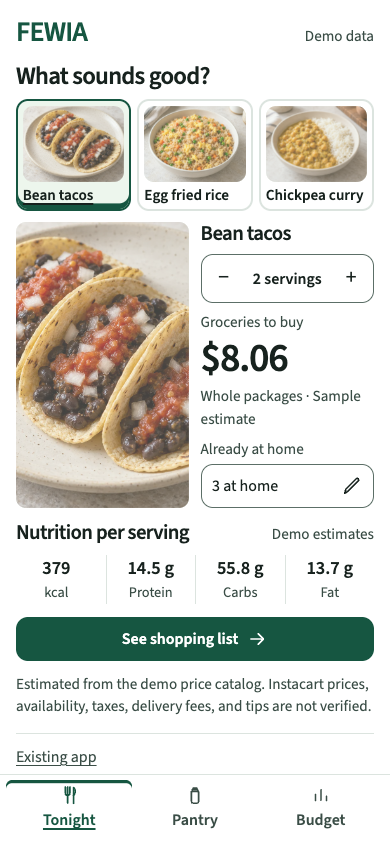
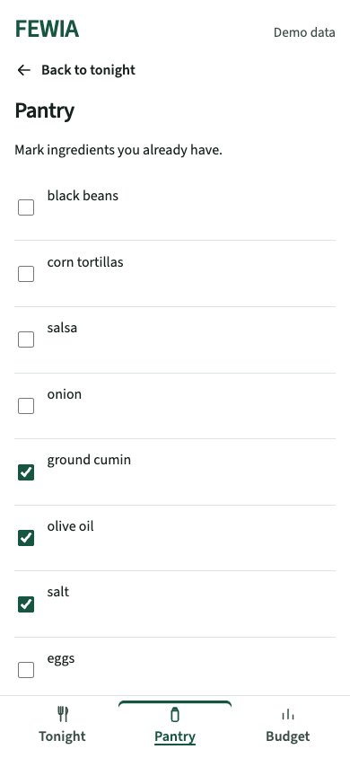
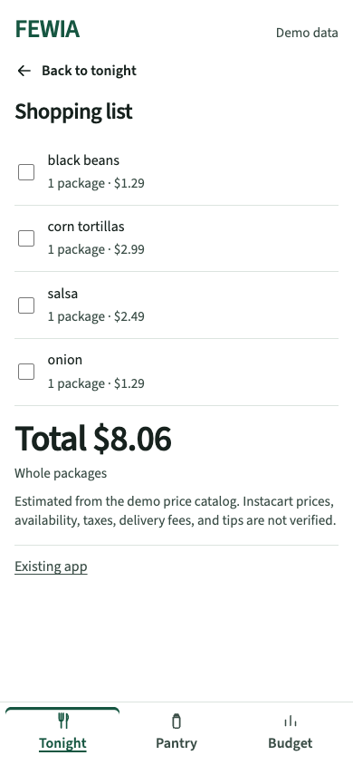
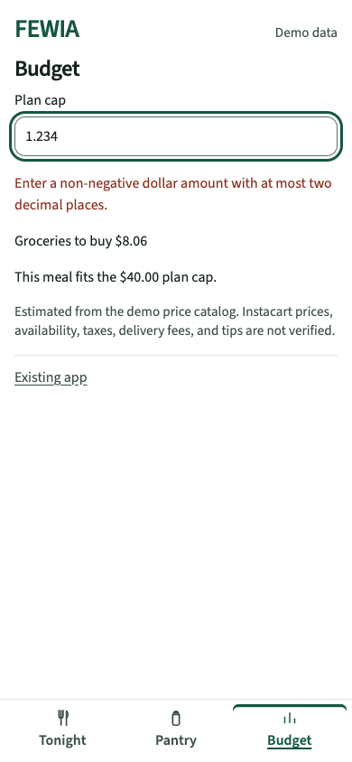

# Tonight prototype WCAG 2.2 AA audit

Date: 2026-10-16. Scope: `/prototype` on `codex/impeccable-young-adult-mocks`.
The baseline is `bcf3d1d`. The audit covers Tonight, Pantry, Shopping list,
and Budget, including invalid amounts, selection, and empty shopping states.
The existing `/` application and external providers are outside this audit.
The repaired source is committed as `741c491`.

This record evaluates the 55 Level A and AA criteria in
[WCAG 2.2](https://www.w3.org/TR/WCAG22/).
It does not claim complete conformance. A later
[VoiceOver audit](tonight-voiceover-audit.md) adds actual Chrome/macOS speech
evidence and two repairs. An accessibility-tree inspection alone is not a
screen-reader test.

## Method

- Capture and inspect all four views in the Codex in-app browser.
- Run axe-core 4.14.0 in a separate local Chromium 155.0.8059.84 browser.
- Check 1280, 844, 719, 520, 390, and 320 CSS-pixel widths.
- Check text at 200% with both root and body font sizes set to 32px.
- Override line height to 1.5, letter spacing to 0.12em, word spacing to
  0.16em, and paragraph spacing to 2em.
- Traverse each view with Tab. Activate controls with Enter and Space.
- Inspect focus visibility, clipping, photo overlap, error recovery, accessible names,
  selection states, and browser accessibility-tree live-region properties.
- Calculate contrast from computed colors. Inspect axe results that need
  manual review. Do not treat zero automated violations as conformance.

The 320 CSS-pixel test supplies the width used by the reflow criterion.
It does not reproduce a physical device or every browser's 400% zoom UI.
Text-size overrides test content growth; they do not change OS font settings.

## Confirmed baseline findings

| Finding | Criterion | Evidence | Required repair |
| --- | --- | --- | --- |
| Pantry label mismatch | 2.5.3, A | Visible `3 at home` or `None marked`; accessible name `Edit pantry`. Axe reports `label-content-name-mismatch`. | Include visible text and the edit action in the accessible name. |
| Faint budget input boundary | 1.4.11, AA | `#dce4df` against white measures 1.30:1. The field has no contrasting fill. | Use a control border that reaches 3:1. Keep decorative dividers separate. |
| Color-only selected state | 1.4.1, A | Active navigation changes only foreground color. Active and inactive colors differ by 1.05:1. Meal selection also uses color. | Add a persistent non-color selection cue. |
| Text clips at 200% | 1.4.4, AA | At 390px, the meal name needs 130px inside 98px. The price needs 174px inside 148px. Serving and nutrition text also overlaps or overflows. | Let columns adapt to enlarged text and preserve every label and value. |

All four findings have severity P1: they affect access to controls or meal facts.
The baseline scan found one distinct automated rule violation. Manual checks
found the other three defects.

The first layout repair exposed a separate photo-sizing regression. At 390px,
the photo covered the adjacent facts despite zero axe violations and no text
overflow. At 520px, its 350px width exceeded its 238px grid column.
Visual inspection caught this. The verification probe now measures intersection
between the photo and facts as well as text overflow.

## Criterion record

`Checked` means the listed source, browser, or visual check found no failure
within this prototype. `N/A` means the relevant content or behavior is absent.
`Partial` records technical evidence with an assistive-technology gap.

| Criterion | Level | Status | Evidence or applicability |
| --- | --- | --- | --- |
| 1.1.1 Non-text Content | A | Checked | Meal photo alternatives describe the meal. Repeated thumbnails and decorative SVGs are hidden from assistive technology. |
| 1.2.1 Audio-only and Video-only | A | N/A | No audio or video. |
| 1.2.2 Captions, Prerecorded | A | N/A | No prerecorded media. |
| 1.2.3 Audio Description or Media Alternative | A | N/A | No prerecorded video. |
| 1.2.4 Captions, Live | AA | N/A | No live media. |
| 1.2.5 Audio Description, Prerecorded | AA | N/A | No prerecorded video. |
| 1.3.1 Info and Relationships | A | Checked | Main, headings, lists, labels, groups, and navigation expose structure. Nutrition values stay beside their labels. |
| 1.3.2 Meaningful Sequence | A | Checked | DOM and reading order follow meal choice, facts, nutrition, shopping action, then navigation. |
| 1.3.3 Sensory Characteristics | A | Checked | Instructions name actions and ingredients, rather than shape or location alone. |
| 1.3.4 Orientation | AA | Checked | Portrait and 844 by 390 landscape layouts retain the controls and content. |
| 1.3.5 Identify Input Purpose | AA | N/A | Plan cap is not one of the specified personal-information input purposes. |
| 1.4.1 Use of Color | A | Checked | Selected meals and navigation use underlines that persist in forced colors. Errors use text. |
| 1.4.2 Audio Control | A | N/A | No audio. |
| 1.4.3 Contrast, Minimum | AA | Checked | Text on white: ink 16.36:1, muted 9.01:1, green 8.60:1, error 8.37:1. White on green is 8.60:1. |
| 1.4.4 Resize Text | AA | Checked | All four views retain content at 200% text at 320 and 390px. Large budget values wrap. |
| 1.4.5 Images of Text | AA | Checked | Labels, facts, and controls use real text. Food images contain no required text. |
| 1.4.10 Reflow | AA | Checked | No text overflow or photo/facts overlap in the tested views, including 320 CSS pixels. |
| 1.4.11 Non-text Contrast | AA | Checked | The control border is now 5.35:1 on white. Green focus indicators exceed 3:1 on white and sage. |
| 1.4.12 Text Spacing | AA | Checked | All four views retain content with the required spacing overrides at 320 and 390px. |
| 1.4.13 Content on Hover or Focus | AA | N/A | No tooltip or other extra content appears on hover or focus. |
| 2.1.1 Keyboard | A | Checked | Tab reaches controls. Enter and Space activate meal, serving, navigation, and checkbox controls. Budget accepts keyboard entry. |
| 2.1.2 No Keyboard Trap | A | Checked | Focus traverses each view and can leave its controls. |
| 2.1.4 Character Key Shortcuts | A | N/A | No authored character shortcuts. |
| 2.2.1 Timing Adjustable | A | N/A | No time limit. |
| 2.2.2 Pause, Stop, Hide | A | N/A | The image fade lasts 220ms. No continuing motion or auto-update. |
| 2.3.1 Three Flashes or Below Threshold | A | Checked | No flashing content. |
| 2.4.1 Bypass Blocks | A | Checked | Main and heading landmarks expose content. View transitions move focus to the new heading. |
| 2.4.2 Page Titled | A | Checked | Document title identifies FEWIA and the meal-budget purpose. |
| 2.4.3 Focus Order | A | Checked | Keyboard order follows the content. View changes focus the heading. Budget typing keeps focus. |
| 2.4.4 Link Purpose, In Context | A | Checked | The sole link is labeled Existing app. |
| 2.4.5 Multiple Ways | AA | N/A | One prototype page with a bounded meal-planning process. |
| 2.4.6 Headings and Labels | AA | Checked | Headings identify each view. Form and group labels identify their purpose. |
| 2.4.7 Focus Visible | AA | Checked | Keyboard controls show a solid 3px outline. |
| 2.4.11 Focus Not Obscured, Minimum | AA | Checked | Focused controls retain visible area within the viewport and scrolling canvas. |
| 2.5.1 Pointer Gestures | A | Checked | Every action uses a single click or tap. |
| 2.5.2 Pointer Cancellation | A | Checked | Native button click and checkbox change handlers act on completed activation. No down-event action. |
| 2.5.3 Label in Name | A | Checked | Pantry names contain the visible count or empty text and the edit action. Symbolic plus/minus controls have descriptive names. |
| 2.5.4 Motion Actuation | A | N/A | No device-motion input. |
| 2.5.7 Dragging Movements | AA | N/A | No dragging operation. |
| 2.5.8 Target Size, Minimum | AA | Checked | Main controls exceed 24px. Checkbox labels enlarge their targets. The isolated footer link satisfies spacing. |
| 3.1.1 Language of Page | A | Checked | HTML declares English. |
| 3.1.2 Language of Parts | AA | N/A | No foreign-language passage. |
| 3.2.1 On Focus | A | Checked | Receiving focus does not navigate or submit. |
| 3.2.2 On Input | A | Checked | Input updates meal data or validation without moving focus or changing view. |
| 3.2.3 Consistent Navigation | AA | Checked | Tonight, Pantry, and Budget retain their order. |
| 3.2.4 Consistent Identification | AA | Checked | Repeated controls retain their labels and function. |
| 3.2.6 Consistent Help | A | N/A | No repeated help mechanism. |
| 3.3.1 Error Identification | A | Checked | Invalid budget input has a text error, aria-invalid, and an associated error description. |
| 3.3.2 Labels or Instructions | A | Checked | Plan cap and pantry inputs have explicit labels. Pantry provides an instruction. |
| 3.3.3 Error Suggestion | AA | Checked | Amount errors specify a non-negative dollar amount and at most two decimal places. Valid input clears the error. |
| 3.3.4 Error Prevention, Legal, Financial, Data | AA | N/A | No transaction, legal commitment, stored user data, or submitted test response. |
| 3.3.7 Redundant Entry | A | Checked | Pantry, servings, and budget persist between prototype views. The process does not require re-entry. |
| 3.3.8 Accessible Authentication, Minimum | AA | N/A | No authentication. |
| 4.1.2 Name, Role, Value | A | Checked | VoiceOver in Chrome reads meal selection, pantry/shopping checkbox names and states, and budget labels, values, invalid state, and descriptions. See the VoiceOver audit for scope. |
| 4.1.3 Status Messages | AA | Partial | VoiceOver verifies contextual meal updates, serving alerts, and budget validation/recovery. The stale serving-error repair has a passing heading-return check; an extra full-sequence repetition was interrupted and remains pending. |

## Verification limits

VoiceOver speech was tested in Chrome on macOS 27.0.1. The follow-up record
contains the captured phrases, repairs, and interrupted repetition. NVDA and
JAWS were not tested. No physical mobile device, Safari, Firefox, OS magnifier,
or speech-input tool was tested.
The audit does not cover the existing application or live backend services.
Generated food images and nutrition fixtures remain demo content.

## Final browser results

All four baseline findings are repaired. The photo-sizing regression is also
resolved. The normal 390px layout keeps the image and facts side by side.
The serving controls stay on one row at normal text size.

- Forty combinations cover four views at six normal viewport sizes, plus
  200% text and spacing overrides at both 320 and 390px.
- These combinations produced zero axe violations, zero measured text
  overflows, and zero intersections between the meal photo and facts.
- Six additional axe scans cover all three meals, empty shopping, zero
  budget, and forced colors. They also produced zero violations.
- Forward and reverse keyboard traversal passed in all four views. Focus
  stayed visible and was not fully obscured. Enter and Space activated controls.
- Budget validation and recovery retained input focus. Canceling a pointer
  click before release left the serving count unchanged.
- The maximum valid budget wrapped at 200% text. Empty pantry naming and
  the all-at-home shopping state retained their expected values.
- Forced-color mode kept selection underlines. Reduced-motion mode removed
  the image animation. The edge-state run recorded no page errors.

Axe left contrast and label-name checks for the symbolic plus/minus controls
as incomplete. Manual inspection found descriptive names and dark text on white.
These were reviewed separately rather than counted as automated passes.

One headed-browser screenshot attempt timed out. A fresh headless browser
completed the final captures and probes. This tooling failure is not a product
pass or failure. The in-app browser supplied separate visual evidence.

The focused UI tests pass 11/11. Gates on source commit `741c491`, before
adding the generated evidence file, report:

```text
SKIP frontend:npm-ci node_modules present
PASS frontend:lint
PASS frontend:test
PASS frontend:build
LINES 1239/1000
RESULT PASS
```

The 1239 line count covers the prototype source against `main`.
After adding the evidence, the same gates pass with `LINES 2108/1000`.
That mechanical count includes 869 lines of generated `results.json`.
Generated evidence is excluded from the repository's source-line cap.
This repair adds 66 source lines against `bcf3d1d`, excluding tests and evidence.
No pull request was opened. Publication still needs the planned prototype stack.

## Captured flow

The [results file](tonight-wcag-evidence/results.json) preserves scan summaries,
keyboard outcomes, edge checks, versions, and the tested source commit.
The captures below show the repaired state. Long lists remain scrollable.

1. Tonight: meal selection, serving controls, price, and nutrition remain visible.

   

2. Pantry: labeled checkbox rows remain readable and keyboard reachable.

   

3. Shopping list: ingredient names, package counts, and total remain readable.

   

4. Budget: the input boundary and focus ring are visible; invalid input has a text error.

   

The [200% text capture](tonight-wcag-evidence/05-text-200.png) shows the meal facts after scrolling.
The [forced-color capture](tonight-wcag-evidence/06-forced-colors.png) shows selection underlines without the green palette.

## Reproduce the checks

Run the prototype as described in [the run guide](tonight-prototype.md).
Use a separate test browser so inspection does not change an existing session.
Run axe with tags `wcag2a`, `wcag2aa`, `wcag21a`, `wcag21aa`, and `wcag22aa`.
Inspect incomplete results manually. Symbolic plus/minus controls need
descriptive names; their names do not need to contain the literal symbols.

Test each view at the widths above. Apply the text and spacing overrides.
Check that text remains readable and all controls remain reachable by scrolling.
Traverse forward and backward with Tab. Use Enter and Space for activation.
Try invalid, zero, and valid budget amounts, each meal, and the empty shopping list.
Confirm that changing meal data clears stale shopping checks.
